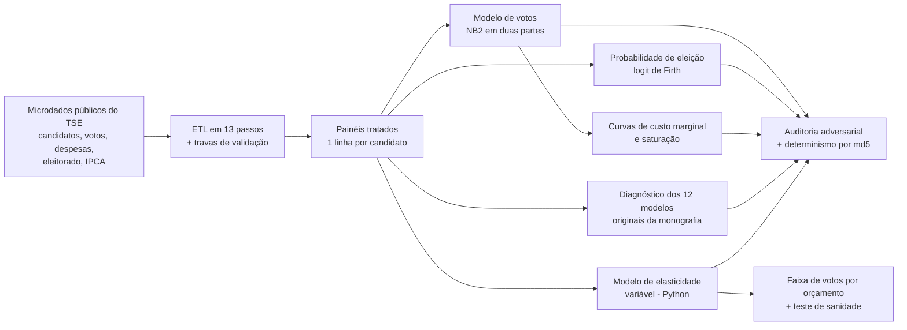

# Impulsionamento digital e eleições: pesquisa econométrica, pipeline reprodutível e modelo de orçamento

> **English summary.** Econometric study of how paid digital promotion ("impulsionamento") spending relates to votes and election outcomes in Paraná, Brazil (state and federal deputy 2018/2022, city council 2020/2024), from an undergraduate thesis in Economics (UFPR). The repository traces the work end to end: the original thesis models (negative binomial + logit); a reproducible, AI-assisted rebuild (13-step ETL with hard validation gates, hurdle negative-binomial, Firth logit, closed-form saturation, byte-identical reruns verified by md5, independent adversarial audit); a diagnostic battery that replicates the 12 thesis models and shows where they fail (functional form rejected in 12/12, clustering, 30-event logits, a silent data-mapping error); and a Python variable-elasticity model that turns a media budget into an expected-results range, with a sanity check that tells you when *not* to trust it.

**Autor:** Luis Lelis (Ciências Econômicas, UFPR) · **Orientação da monografia:** Profª. Drª. Adriana Sbicca Fernandes. O artigo derivado da monografia, de Lelis e Sbicca, foi apresentado no ANPEC Sul 2026 (mesa "Ciclo Político e Finanças").

---

## O problema

Desde a regulamentação do impulsionamento pago de conteúdo (Lei nº 13.488/2017), campanhas passaram a gastar em uma categoria nova, que a literatura brasileira sobre financiamento de campanha ainda tratava de forma agregada. A pergunta de negócio é a de qualquer gestor de mídia: **quanto resultado cada real em cada canal compra, a partir de que ponto o retorno cai, e com que grau de confiança se pode dizer isso?**

Há três dificuldades, comuns a qualquer análise de retorno de marketing:

1. **O dado é sujo e o erro é silencioso.** Os microdados públicos do TSE têm rubricas de despesa em texto livre, CPF mascarado em alguns anos e registros multiplicáveis por *join*; um erro de classificação ou de junção vira número plausível.
2. **O modelo não é a verdade.** A relação gasto → votos é endógena (quem tem chance gasta mais), a resposta ao gasto não é linear e a maior parte dos candidatos nem usa a ferramenta.
3. **O resultado precisa virar decisão.** Um coeficiente não diz quanto investir. Um orçamento precisa virar uma *faixa* de resultado esperado, com a incerteza explícita.

## A solução, em quatro etapas

1. **Monografia (2025).** Modelos de contagem (binomial negativa, para votos) e logit (probabilidade de eleição) com o gasto separado em **impulsionamento, publicidade tradicional e operacional**, para o Paraná em quatro eleições (2018 a 2024), controlando por capital político. Achado: o impulsionamento se consolida em 2022 e 2024 como a categoria de maior elasticidade-voto; nas disputas de grande escala o gasto digital não determina a eleição, e a reeleição domina em todos os cenários. A monografia está em [`monografia/`](monografia/).
2. **Reconstrução reprodutível.** O mesmo problema refeito como um pipeline de engenharia: ETL de 13 passos com travas de validação, modelo em duas partes (adotar × quanto gastar), logit de Firth, curvas de custo marginal e saturação por fórmula fechada, versões de pacotes travadas e reexecução verificada por md5. A reconstrução foi feita **com assistência de IA (Claude Code), sob auditoria** (ver abaixo).
3. **Diagnóstico dos 12 modelos originais.** Os modelos da monografia foram reproduzidos e submetidos a uma bateria de testes. O resultado é um mapa honesto do que se sustenta e do que não: a forma funcional é rejeitada em 12 de 12 recortes, o erro-padrão ignora o agrupamento por município, o logit de deputado federal tem só 30 eventos e um erro de grafia no mapeamento de rubricas descartou R$ 30,6 milhões da conta.
4. **Modelo de elasticidade variável (Python).** A resposta técnica ao item 3: uma binomial negativa com elasticidade que depende do nível de gasto, usada para **transformar um orçamento de mídia numa faixa de resultado esperado**, acompanhada de um teste de sanidade que mostra quando a conta é otimista demais.

## Arquitetura



## Técnicas de IA e engenharia

- **Código gerado com IA, verificado por outra instância.** A implementação foi produzida com Claude Code a partir de uma especificação escrita pelo autor; a verificação foi feita por um **agente separado, em contexto isolado, com a tarefa explícita de refutar os resultados** (checagem adversarial), e não pelo mesmo agente que escreveu o código.
- **ETL com travas que *param* o processo.** Teto legal por cargo e ano, multiplicação de linhas, valores negativos, fator de deflação fora de [0,5; 2,5] e fonte ausente interrompem a execução em vez de gravar um número impossível.
- **Classificação auditável.** A rubrica de cada despesa é classificada por regras de texto explícitas, e um CSV de auditoria lista rubrica, classe, soma e número de lançamentos.
- **Modelagem estatística:** binomial negativa tipo 2 (`glmmTMB`) em duas partes (indicador de uso e log do gasto entre usuários); logit de Firth (`logistf`); logit fracionário; erros-padrão HC3 e agrupados por município; sensibilidade de Oster; curvas de saturação por fórmula fechada; *bootstrap* paramétrico; deflação por IPCA com tabela versionada.
- **Reprodutibilidade:** `renv` (R 4.6.0), sementes fixas, caminhos por variável de ambiente, saída idêntica por md5 em execuções repetidas.

## Controles de qualidade e governança

| Controle | Como funciona |
|---|---|
| Humano na especificação | A especificação (modelos, decisões econométricas e travas) é do autor; a implementação foi feita com assistência de IA |
| Quem produz não verifica | Auditoria adversarial feita por agente separado, em contexto isolado |
| Travas de dados | Paradas duras antes de salvar (teto legal, fan-out, sinal, deflação, fonte ausente) |
| Conferência contra o bruto | Agregados do painel batem com o bruto do TSE (razão 1,000000) |
| Determinismo | Duas execuções do zero: 131 arquivos (painéis, tabelas e figuras) idênticos por md5 |
| Reprodução dos modelos originais | Tamanhos de amostra e estatísticas impressas na monografia reproduzidos |
| Teste de sanidade do modelo | A curva de resposta é confrontada com o custo real do eleito típico e **reprovada** |
| Verificação independente | O modelo de elasticidade foi refeito do zero por um auditor (divergência máxima de 0,91%) |
| Dados pessoais | Os painéis com nome de candidato e os caches brutos do TSE (que contêm CPF, e-mail e nascimento) não entram no repositório; o código descarta colunas de identificação |

Detalhes em [`docs/05_auditoria_e_reprodutibilidade.md`](docs/05_auditoria_e_reprodutibilidade.md).

## Como rodar

**Requisitos:** R 4.6.0 (pacotes travados em `R/renv.lock`) e Python 3.12 (`python/requirements.txt`).

```bash
# 1. Ambiente R (restaura as versões travadas em R/renv.lock)
cd R && Rscript -e 'renv::restore()' && cd ..

# 2. Dados do TSE em dados/ (ver a tabela abaixo; não fazem parte do repositório)

# 3. Pipeline: ETL -> modelos -> saturação -> relatório. Saída em execucao/
Rscript R/pipeline/run_all.R

# 4. Diagnóstico dos 12 modelos da monografia
Rscript R/diagnosticos/run_all.R

# 5. Modelo de elasticidade variável (Python), com DADOS SINTÉTICOS
pip install -r python/requirements.txt
python exemplos/gerar_paineis_sinteticos.py
cd python/modelo_elasticidade
python 01_prep.py --painel-dir ../../exemplos/paineis_sinteticos --saida ../../execucao/elasticidade
for s in 02_modelos 03_curva_elasticidade 04_banda_envelope 05_checagens_suporte; do
  python $s.py --saida ../../execucao/elasticidade
done
```

Para usar o `renv` ao rodar os scripts em R, execute-os a partir de `R/` (por exemplo, `cd R && Rscript pipeline/run_all.R`); a raiz do repositório é detectada automaticamente. Variáveis de ambiente opcionais (ver `.env.example`): `TSE_DADOS` (padrão `dados/`), `IMPULSIONAMENTO_SAIDA` (padrão `execucao/`) e `ELASTICIDADE_SAIDA`.

Com os painéis reais gerados no passo 3, o módulo em Python (`--painel-dir execucao/dados_tratados`) reproduz as tabelas de [`resultados/tabelas/modelo_elasticidade/`](resultados/tabelas/modelo_elasticidade/).

**Dados esperados em `dados/`** (todos públicos, do TSE):

| Arquivo | Conteúdo | Usado por |
|---|---|---|
| `candidato_<ano>_PR.rds`, 2012 a 2024 (anos de eleição) | cadastro de candidatos | pipeline |
| `voto_<ano>_PR.rds`, 2012 a 2024 | votos nominais por município e zona | pipeline |
| `despesa_<ano>_PR.rds`, 2018, 2020, 2022, 2024 | prestação de contas (despesas contratadas) | pipeline |
| `consulta_cand_complementar_<ano>.zip`, 2018 a 2024 | indicador de reeleição | pipeline |
| `detalhe_votacao_munzona_<ano>.zip`, 2020 e 2024 | eleitorado apto por município | pipeline |
| `consulta_cand_<ano>.zip`, `consulta_cand_complementar_<ano>.zip`, `prestacao_de_contas_eleitorais_candidatos_<ano>.zip`, `votacao_candidato_munzona_<ano>.zip`, 2018 a 2024 | pacotes originais do Repositório de Dados Eleitorais | diagnósticos |

Os arquivos `.rds` de candidato, voto e despesa são gerados (e guardados em cache) pela função `obter_tse()` de [`R/01_tratamento.R`](R/01_tratamento.R) (pacote `electionsBR` e CDN do TSE); os pacotes `.zip` vêm do Portal de Dados Abertos do TSE.

## Resultados mensuráveis

Todos os números abaixo vêm das tabelas e dos documentos do repositório.

**Escopo.** 12 recortes: deputado federal (450 e 632 candidatos em 2018 e 2022), deputado estadual (767 e 902) e vereador (34.329 candidatos em 2020 e 30.773 em 2024, em quatro portes de município).

**Efeito do impulsionamento (modelo reconstruído).** Fator de votos de um usuário contra um não usuário, no mesmo gasto de referência de cada cenário:

| Recorte | 2018 / 2020 | 2022 / 2024 |
|---|---:|---:|
| Deputado federal | 2,09 | 2,66 |
| Deputado estadual | 1,78 | 2,30 |
| Vereador, município pequeno | 1,22 | 1,43 |
| Vereador, metrópole (Curitiba) | 1,94 | 2,55 |

Em 2022 o impulsionamento passa a ser a categoria de maior fator no deputado federal, e o modelo reconstruído tem AIC menor que o da especificação original em **12 de 12** recortes (mesma amostra, mesma família).

**O que os diagnósticos dos modelos originais encontraram** ([`docs/04`](docs/04_diagnosticos_dos_modelos_do_tcc.md)):

- **Forma funcional rejeitada em 12 de 12** recortes (teste conjunto de termos quadráticos, LR de 42 a 237): a elasticidade não é constante.
- **Erros-padrão do vereador ignoram o município.** Candidatos do mesmo município não são independentes: com um intercepto por município, a elasticidade do impulsionamento cai de 6% a 43%, e o efeito de desenho aproximado (5,8 a 14,3) indica, como limite superior para quantidades de nível municipal, erros-padrão subestimados por um fator de 2,4 a 3,8 (o erro-padrão agrupado efetivamente estimado fica entre 0,76 e 1,56 vez o original). Corrigir o erro-padrão não corrige o viés do ponto estimado.
- **Logit de deputado federal instável:** 30 eleitos para 10 parâmetros (3,0 eventos por variável); em 500 reamostras *bootstrap*, o coeficiente do impulsionamento em 2022 vai de −0,28 a +13,06, e a correção de Firth o corta de 0,375 para 0,182. Não era separação, era escassez de eventos.
- **Um erro de rubrica:** a grafia "television" no mapa de 2024 descartou R$ 30,6 milhões (4.089 lançamentos) de produção de rádio, TV e vídeo; o efeito nas estimativas é pequeno (até 2,1%).
- **O achado central, testado formalmente:** o retorno do impulsionamento cresce com o porte do município em **2024** (p = 0,0001, resiste à separação das margens e ao efeito municipal), mas o gradiente de **2020** é frágil (p = 0,027 no teste ingênuo; p = 0,499 ao separar adoção e intensidade).

**Reprodutibilidade.** Nas duas execuções completas do pipeline, os 131 arquivos gerados (18 arquivos tratados entre painéis, auditorias de rubrica e logs, 89 tabelas e 24 figuras) são idênticos por md5. Ao montar este repositório, o pipeline completo foi reexecutado do zero (cerca de 20 minutos), com os caminhos já parametrizados, e os 131 arquivos saíram novamente idênticos por md5 aos originais; o mesmo vale para as 38 tabelas e 28 figuras da bateria de diagnósticos (cerca de 41 minutos).

**Modelo de elasticidade variável** (deputado federal, n = 515 usuários de impulsionamento): a elasticidade constante é rejeitada (LR = 27,36; p < 0,001) e `b(g)` sobe de 0,17 (p10 do gasto) a 0,40 (mediana) e 0,75 (p99). Um orçamento de R$ 100 mil vira uma faixa de cerca de **11,2 mil a 17,5 mil votos** (P10 a P90 da média), com P50 de 13,9 mil; a faixa preditiva individual vai de cerca de 1.500 a 34.000. O **teste de sanidade reprova a conta em todos os orçamentos**: o modelo promete voto a R$ 7,17 (custo médio), contra R$ 22,39 por voto do eleito típico de 2022. A leitura recomendada é usar a faixa como teto de potencial e a régua `orçamento ÷ R$ 22,39` como cenário realista ([`docs/06`](docs/06_modelo_de_elasticidade_variavel.md)).

## Limitações

- **Associação, não causalidade.** Não há desenho de identificação: candidatos com melhores perspectivas arrecadam e gastam mais. As elasticidades são associações condicionais, e os custos por voto e a saturação são descritivos. O viés esperado é para cima.
- **Suporte fino no topo e suporte conjunto irreal.** Só 9 candidatos gastaram R$ 250 mil ou mais em impulsionamento, e quem gasta muito nele também gasta muito nas demais rubricas: o "candidato médio com orçamento alto" não existe na amostra.
- **Dados autodeclarados** na prestação de contas, sujeitos a subdeclaração; os anos são cortes transversais, não uma série temporal.
- **Validade entre ciclos:** o nível de votos por real muda entre eleições (o coeficiente de 2022 é −1,04 em log), por custo de mídia, regras e concorrência.
- **Escopo geográfico:** Paraná; a generalização para outros estados não foi testada neste repositório.

## O que isso mostra para uma empresa

O assunto é eleitoral, mas o padrão é o de qualquer área que decide gasto com base em dado e em modelo:

- **Marketing e mídia:** curva de resposta e ponto de saturação por canal, e conversão de um orçamento em *faixa* de resultado com a incerteza dita, em vez de uma promessa pontual.
- **Backoffice e finanças:** classificação de lançamentos por regras auditáveis (com CSV de auditoria), e travas de validação que interrompem o processo antes de um número impossível chegar a um relatório.
- **Dados e engenharia:** pipeline determinístico, com saída idêntica por md5, versões travadas e caminhos parametrizados, que qualquer pessoa reexecuta.
- **Implementação de IA com controle:** a IA escreve o código a partir de uma especificação humana, **outra instância tenta refutá-lo**, e os controles (travas, determinismo, conferência contra o bruto, teste de sanidade) são reexecutáveis. A confiança está nos controles, não no gerador.
- **Atendimento e operações:** a mesma disciplina de diagnosticar o modelo antes de confiar nele (forma funcional, dependência entre observações, poucos eventos) vale para qualquer previsão de volume, de demanda ou de SLA.

## Estrutura do repositório

```
impulsionamento-digital-eleicoes/
├── README.md
├── LICENSE                       MIT (código)
├── LICENSE-docs.md               CC BY 4.0 (documentação, monografia e resultados)
├── .env.example                  variáveis de caminho opcionais (não há segredos)
├── monografia/
│   └── TCC_Luis_Lelis_UFPR_2025.pdf
├── R/
│   ├── .Rprofile, renv.lock, renv/
│   ├── 01_tratamento.R           ETL genérico por (UF, ano, cargo)
│   ├── modelo_impulsionamento.R  motor de estimação alternativo
│   ├── pipeline/                 pipeline reprodutível (00_setup ... 08_relatorio, run_all)
│   └── diagnosticos/             bateria de diagnóstico dos 12 modelos (run_all e scripts 00 a 10)
├── python/
│   ├── requirements.txt
│   └── modelo_elasticidade/      modelo de elasticidade variável (01 a 05)
├── exemplos/
│   ├── gerar_paineis_sinteticos.py
│   ├── paineis_sinteticos/       dados fictícios no esquema dos painéis reais
│   └── saida_demo/               saída da demonstração
├── dicionarios/                  IPCA, densidade, IDHM/Gini/internet, população e mapas de rubricas
├── docs/
│   ├── 01_metodologia.md
│   ├── 02_etl_tratamento.md
│   ├── 03_evolucao_do_modelo.md
│   ├── 04_diagnosticos_dos_modelos_do_tcc.md
│   ├── 05_auditoria_e_reprodutibilidade.md
│   └── 06_modelo_de_elasticidade_variavel.md
└── resultados/
    ├── RELATORIO_RESULTADOS.md   coeficientes e leitura, recorte a recorte
    ├── figuras/                  curvas de custo marginal e painéis de diagnóstico
    └── tabelas/                  pipeline/, diagnosticos/, modelo_elasticidade/
```

## Licença

Código sob licença MIT. A documentação, o texto da monografia e os resultados estão sob **CC BY 4.0** (ver [`LICENSE-docs.md`](LICENSE-docs.md)). Os microdados são públicos (TSE) e não fazem parte do repositório.
