# Relatorio de resultados: gastos de campanha e votos (PR)

Resultados do modelo unico de votos, por recorte
(deputado federal e estadual, 2018 e 2022) e por porte (vereador, 2020 e 2024).
Estudo COMPARATIVO entre as tres categorias de gasto: impulsionamento digital,
publicidade tradicional e gasto operacional. Valores monetarios na moeda da base
do escopo: deputado em R$ de out/2022; vereador em R$ de out/2024.
Fontes numericas: `tabelas/pipeline/`; metodo completo em
`docs/01_metodologia.md`; auditoria dos resultados em
`docs/05_auditoria_e_reprodutibilidade.md`.

## Como ler os coeficientes (template unico)

- O modelo de votos e' Binomial Negativa (NB2) com ligacao log: um coeficiente b
  le-se como 100*(exp(b)-1)% de variacao nos votos esperados por +1 unidade da
  variavel, mantido o resto constante.
- `usou_<categoria>` (margem extensiva): efeito de ADOTAR a categoria, em pontos
  log; sozinho costuma ser negativo porque e' o intercepto de quem usa com dose
  proxima de zero, e so faz sentido lido junto da dose.
- `lg_<categoria>` (dose intensiva): elasticidade entre usuarios; +1% de gasto
  associa-se a +b% de votos. E' a inclinacao da curva de dose.
- EFEITO COMBINADO da categoria: exp(b_usou + b_lg * log(gasto de referencia));
  fator de votos de um usuario tipico contra um nao usuario, no MESMO gasto de
  referencia para as tres categorias, o que torna os fatores comparaveis no
  mesmo dinheiro. Ex.: fator 2,3 significa 2,3 vezes os votos, ou +130%.
- GASTO DE REFERENCIA UNICO do cenario: mediana do gasto positivo por categoria,
  agrupando as tres categorias entre quem gastou; um valor por recorte e porte,
  aplicado igual as tres categorias, na moeda da base do escopo.
- `reeleicao` (dummy): 100*(exp(b)-1)% por ser incumbente; ler junto de
  `l_votos_mesmo_cargo_ultima`. O EFEITO CONJUNTO DE INCUMBENCIA e' o fator
  exp(b_reeleicao + b_lvotos * votacao tipica de um incumbente, em log1p),
  contra um desafiante sem historico; e' a leitura correta porque a dummy e a
  votacao anterior sao colineares (todo incumbente tem votacao anterior).
- `l_votos_<cargo>_<quando>`: elasticidade do capital politico daquele cargo;
  +1% de voto anterior associa-se a +b% de votos agora.
- Controles (masculino, superior_completo, corbranca, esquerda, direita):
  100*(exp(b)-1)% da categoria contra a base (mulher; sem superior; nao branco;
  centro).
- `l_apto` (vereador): elasticidade do voto ao eleitorado; entre 0 e 1, o voto
  cresce menos que proporcional ao tamanho do municipio.
- Significancia: *** 0,1%; ** 1%; * 5%; . 10%.

## Curvas comparativas e saturacao: como foram calculadas

Entre usuarios de uma categoria, os votos previstos vem da margem intensiva do
modelo: votos(g) = exp(eta_ref + b_lg * log g) = K * g^b_lg, com K = exp(eta_ref)
o nivel do perfil de referencia (usuario da categoria, demais variaveis na media
da amostra do recorte; no vereador, eleitorado apto na mediana do porte). O
custo marginal por voto e' a derivada inversa d(gasto)/d(votos previstos), que
na forma fechada e' g^(1-b_lg)/(K*b_lg). O ponto de saturacao pratica e' o gasto
g* em que o custo marginal atinge o limiar L: g* = (K*b_lg*L)^(1/(1-b_lg)).
O limiar e' a MEDIA dos custos individuais (gasto total dividido por votos),
entre os eleitos e no conjunto geral do recorte. A saturacao nao e' reportada
quando a dose intensiva da categoria nao e' distinta de zero a 5% (g* colapsa
quando b_lg tende a zero). As tres categorias aparecem no mesmo grafico, cada
uma na sua faixa observada de gasto (ate o quantil 99% do gasto dos usuarios);
a leitura e' comparativa.

Nota de leitura para contrastes entre anos: o ponto de saturacao depende do
nivel K do perfil de referencia do proprio ano. No federal, K cai de 2018 para
2022 (mais candidatos dividindo praticamente os mesmos votos), e por isso a
saturacao de 2022 e' menor mesmo com dose e limiar maiores; a decomposicao
completa esta em `docs/05_auditoria_e_reprodutibilidade.md` (item 5).

---

## PR 2018, Deputado Federal

Amostra do modelo de votos: n = 415 (de 450 candidatos; 30 eleitos). AIC = 7.630,5; theta (dispersao NB2) = 1,098. Gasto de referencia unico do cenario: R$ 7.389.

### Coeficientes completos

| termo | estimativa | EP | p | sig |
|---|---:|---:|---:|---|
| (Intercept) | 6,1481 | 0,1912 | 6,23e-227 | *** |
| usou_impulsionamento | -1,0004 | 0,3758 | 7,76e-03 | ** |
| lg_impulsionamento | 0,1949 | 0,0449 | 1,44e-05 | *** |
| usou_tradicional | -2,3570 | 0,3384 | 3,26e-12 | *** |
| lg_tradicional | 0,3860 | 0,0386 | 1,62e-23 | *** |
| usou_operacional | -0,4723 | 0,2118 | 2,58e-02 | * |
| lg_operacional | 0,0646 | 0,0233 | 5,58e-03 | ** |
| reeleicao | -0,6059 | 0,3445 | 7,86e-02 | . |
| l_votos_mesmo_cargo_ultima | 0,1192 | 0,0250 | 1,81e-06 | *** |
| l_votos_dep_estadual_ultima | 0,0697 | 0,0211 | 9,72e-04 | *** |
| l_votos_prefeito_ultima | 0,0033 | 0,0270 | 9,01e-01 |  |
| l_votos_prefeito_penultima | 0,0099 | 0,0274 | 7,19e-01 |  |
| l_votos_vereador_ultima | 0,0445 | 0,0172 | 9,75e-03 | ** |
| masculino | 0,4366 | 0,1112 | 8,64e-05 | *** |
| superior_completo | 0,1263 | 0,1140 | 2,68e-01 |  |
| corbranca | 0,2833 | 0,1341 | 3,46e-02 | * |
| esquerda | -0,3365 | 0,1231 | 6,28e-03 | ** |
| direita | -0,0172 | 0,1249 | 8,91e-01 |  |

### Leitura de cada variavel

- `usou_impulsionamento` (margem extensiva de impulsionamento): -1,000 pontos log ao passar de nao usar para usar a categoria; distinto de zero a 1% (**). Costuma ser negativo porque e' o intercepto de quem usa com dose proxima de zero; leia junto da dose e do efeito combinado.
- `lg_impulsionamento` (dose intensiva de impulsionamento, elasticidade entre usuarios): +1% de gasto associa-se a +0,195% de votos; distinto de zero a 0,1% (***). E' a inclinacao da curva de dose.
- `usou_tradicional` (margem extensiva de publicidade tradicional): -2,357 pontos log ao passar de nao usar para usar a categoria; distinto de zero a 0,1% (***). Costuma ser negativo porque e' o intercepto de quem usa com dose proxima de zero; leia junto da dose e do efeito combinado.
- `lg_tradicional` (dose intensiva de publicidade tradicional, elasticidade entre usuarios): +1% de gasto associa-se a +0,386% de votos; distinto de zero a 0,1% (***). E' a inclinacao da curva de dose.
- `usou_operacional` (margem extensiva de gasto operacional): -0,472 pontos log ao passar de nao usar para usar a categoria; distinto de zero a 5% (*). Costuma ser negativo porque e' o intercepto de quem usa com dose proxima de zero; leia junto da dose e do efeito combinado.
- `lg_operacional` (dose intensiva de gasto operacional, elasticidade entre usuarios): +1% de gasto associa-se a +0,065% de votos; distinto de zero a 1% (**). E' a inclinacao da curva de dose.
- `reeleicao`: ser incumbente associa-se a -45,4% nos votos esperados contra nao incumbente; distinto de zero apenas a 10% (.). Ler junto de `l_votos_mesmo_cargo_ultima`: o efeito conjunto de incumbencia esta logo abaixo.
- `l_votos_mesmo_cargo_ultima` (elasticidade do capital politico: votacao do candidato para o mesmo cargo na eleicao anterior): +1% de votos naquela eleicao associa-se a +0,119% de votos agora; distinto de zero a 0,1% (***).
- `l_votos_dep_estadual_ultima` (elasticidade do capital politico: votacao anterior para deputado estadual): +1% de votos naquela eleicao associa-se a +0,070% de votos agora; distinto de zero a 0,1% (***).
- `l_votos_prefeito_ultima` (elasticidade do capital politico: votacao para prefeito na ultima municipal): +1% de votos naquela eleicao associa-se a +0,003% de votos agora; nao distinto de zero.
- `l_votos_prefeito_penultima` (elasticidade do capital politico: votacao para prefeito na penultima municipal): +1% de votos naquela eleicao associa-se a +0,010% de votos agora; nao distinto de zero.
- `l_votos_vereador_ultima` (elasticidade do capital politico: votacao para vereador na ultima municipal): +1% de votos naquela eleicao associa-se a +0,044% de votos agora; distinto de zero a 1% (**).
- `masculino`: 54,7% de votos (candidatos homens contra mulheres); distinto de zero a 0,1% (***).
- `superior_completo`: 13,5% de votos (superior completo contra sem superior completo); nao distinto de zero.
- `corbranca`: 32,8% de votos (autodeclarados brancos contra nao brancos); distinto de zero a 5% (*).
- `esquerda`: -28,6% de votos (partidos de esquerda contra o centro); distinto de zero a 1% (**).
- `direita`: -1,7% de votos (partidos de direita contra o centro); nao distinto de zero.
- EFEITO CONJUNTO DE INCUMBENCIA: um incumbente tipico (votacao anterior de 95.841 votos, mediana entre os 25 incumbentes da amostra) tem fator 2,14 de votos (114,1%) contra um desafiante sem historico; p = 1,4e-03 (**). E' a leitura correta de reeleicao + votacao anterior juntas.

### Efeito combinado das tres categorias (mesmo gasto de referencia, R$ 7.389)

| categoria | fator de votos | variacao | p | sig |
|---|---:|---:|---:|---|
| tradicional | 2,95 | 194,9% | 7,32e-13 | *** |
| impulsionamento | 2,09 | 108,8% | 4,39e-09 | *** |
| operacional | 1,11 | 10,8% | 5,17e-01 |  |

No mesmo dinheiro (R$ 7.389), a ordem dos fatores de votos e': tradicional (2,95), impulsionamento (2,09), operacional (1,11). O fator compara um usuario tipico da categoria, naquele gasto, com um nao usuario.

### Comparacao com a especificacao da monografia

Mesma amostra e mesma familia NB2; muda a especificacao: a monografia usava
log1p do gasto unico por categoria e so a dummy de reeleicao como capital.

| medida | monografia | sig | atual | sig |
|---|---:|---|---:|---|
| elasticidade_impulsionamento (mono: log1p unico; atual: dose intensiva lg) | 0,0979 | *** | 0,1949 | *** |
| efeito_combinado_impulsionamento (fator de votos no gasto de referencia unico; so atual) | n/d |  | 2,0875 | *** |
| elasticidade_tradicional (mono: log1p unico; atual: dose intensiva lg) | 0,1592 | *** | 0,3860 | *** |
| efeito_combinado_tradicional (fator de votos no gasto de referencia unico; so atual) | n/d |  | 2,9486 | *** |
| elasticidade_operacional (mono: log1p unico; atual: dose intensiva lg) | 0,0805 | *** | 0,0646 | ** |
| efeito_combinado_operacional (fator de votos no gasto de referencia unico; so atual) | n/d |  | 1,1085 |  |
| reeleicao | 1,0453 | *** | -0,6059 | . |
| l_votos_mesmo_cargo_ultima (so atual) | n/d |  | 0,1192 | *** |
| AIC | 7.745,9385 |  | 7.630,4862 |  |
| theta | 0,8598 |  | 1,0981 |  |

Leitura: a dose intensiva do impulsionamento entre usuarios (0,195) e' maior que a elasticidade log1p unica da monografia (0,098) porque o log1p unico dilui a dose entre os nao usuarios. A incumbencia, que na monografia era so a dummy de reeleicao (1,045), agora se reparte entre a dummy (-0,606) e a votacao anterior do mesmo cargo, entao os dois termos atuais leem-se juntos (efeito conjunto acima). AIC: atual 7.630,5 contra 7.745,9 da monografia (o modelo atual ajusta melhor).

### Curvas comparativas e saturacao das tres categorias

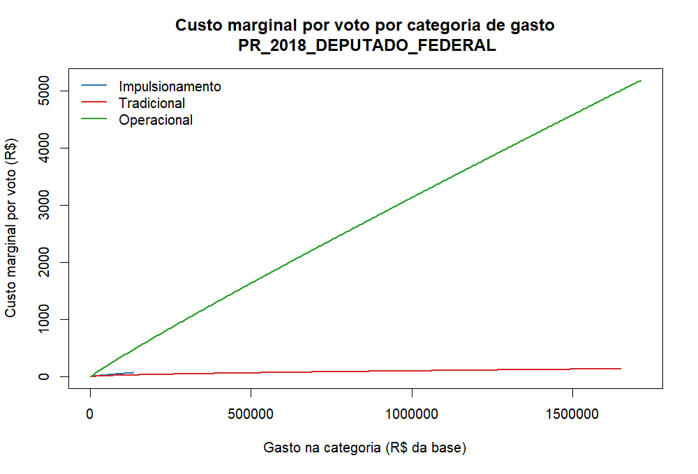

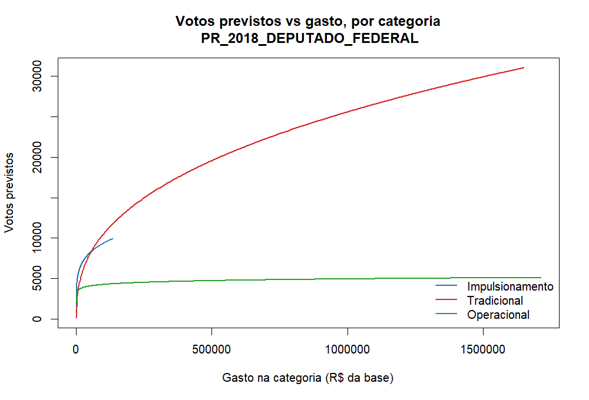

Limiar de custo por voto (media dos custos individuais): eleitos R$ 16; geral R$ 25.

| categoria | dose intensiva (b_lg) | n usuarios | saturacao (limiar eleitos) | saturacao (limiar geral) | faixa observada ate |
|---|---:|---:|---:|---:|---:|
| impulsionamento | 0,195 | 168 | R$ 22.361 | R$ 38.087 | R$ 134.745 |
| tradicional | 0,386 | 310 | R$ 51.565 | R$ 103.662 | R$ 1.650.839 |
| operacional | 0,065 | 318 | R$ 3.637 | R$ 5.752 | R$ 1.712.964 |

O ponto de saturacao e' o gasto na categoria a partir do qual cada voto
adicional custa mais do que o limiar (formula fechada na secao de metodo).
'Alem da faixa observada' significa que o cruzamento fica acima do quantil
99% do gasto observado dos usuarios, ou seja, e' extrapolacao.

---

## PR 2022, Deputado Federal

Amostra do modelo de votos: n = 600 (de 632 candidatos; 30 eleitos). AIC = 10.337,0; theta (dispersao NB2) = 1,142. Gasto de referencia unico do cenario: R$ 16.258.

### Coeficientes completos

| termo | estimativa | EP | p | sig |
|---|---:|---:|---:|---|
| (Intercept) | 5,0661 | 0,1794 | 1,83e-175 | *** |
| usou_impulsionamento | -1,2618 | 0,2459 | 2,86e-07 | *** |
| lg_impulsionamento | 0,2310 | 0,0283 | 2,99e-16 | *** |
| usou_tradicional | -2,0253 | 0,2815 | 6,31e-13 | *** |
| lg_tradicional | 0,2795 | 0,0271 | 5,16e-25 | *** |
| usou_operacional | -1,1950 | 0,2360 | 4,11e-07 | *** |
| lg_operacional | 0,1667 | 0,0193 | 5,37e-18 | *** |
| reeleicao | 0,7689 | 0,2802 | 6,07e-03 | ** |
| l_votos_mesmo_cargo_ultima | 0,0432 | 0,0183 | 1,84e-02 | * |
| l_votos_dep_estadual_ultima | 0,0239 | 0,0181 | 1,86e-01 |  |
| l_votos_prefeito_ultima | -0,0205 | 0,0186 | 2,71e-01 |  |
| l_votos_prefeito_penultima | 0,1648 | 0,0270 | 1,06e-09 | *** |
| l_votos_vereador_ultima | 0,0160 | 0,0140 | 2,53e-01 |  |
| masculino | 0,5789 | 0,0836 | 4,4e-12 | *** |
| superior_completo | 0,4595 | 0,0830 | 3,05e-08 | *** |
| corbranca | 0,1191 | 0,0902 | 1,87e-01 |  |
| esquerda | 0,1270 | 0,1083 | 2,41e-01 |  |
| direita | 0,2950 | 0,0901 | 1,06e-03 | ** |

### Leitura de cada variavel

- `usou_impulsionamento` (margem extensiva de impulsionamento): -1,262 pontos log ao passar de nao usar para usar a categoria; distinto de zero a 0,1% (***). Costuma ser negativo porque e' o intercepto de quem usa com dose proxima de zero; leia junto da dose e do efeito combinado.
- `lg_impulsionamento` (dose intensiva de impulsionamento, elasticidade entre usuarios): +1% de gasto associa-se a +0,231% de votos; distinto de zero a 0,1% (***). E' a inclinacao da curva de dose.
- `usou_tradicional` (margem extensiva de publicidade tradicional): -2,025 pontos log ao passar de nao usar para usar a categoria; distinto de zero a 0,1% (***). Costuma ser negativo porque e' o intercepto de quem usa com dose proxima de zero; leia junto da dose e do efeito combinado.
- `lg_tradicional` (dose intensiva de publicidade tradicional, elasticidade entre usuarios): +1% de gasto associa-se a +0,280% de votos; distinto de zero a 0,1% (***). E' a inclinacao da curva de dose.
- `usou_operacional` (margem extensiva de gasto operacional): -1,195 pontos log ao passar de nao usar para usar a categoria; distinto de zero a 0,1% (***). Costuma ser negativo porque e' o intercepto de quem usa com dose proxima de zero; leia junto da dose e do efeito combinado.
- `lg_operacional` (dose intensiva de gasto operacional, elasticidade entre usuarios): +1% de gasto associa-se a +0,167% de votos; distinto de zero a 0,1% (***). E' a inclinacao da curva de dose.
- `reeleicao`: ser incumbente associa-se a 115,7% nos votos esperados contra nao incumbente; distinto de zero a 1% (**). Ler junto de `l_votos_mesmo_cargo_ultima`: o efeito conjunto de incumbencia esta logo abaixo.
- `l_votos_mesmo_cargo_ultima` (elasticidade do capital politico: votacao do candidato para o mesmo cargo na eleicao anterior): +1% de votos naquela eleicao associa-se a +0,043% de votos agora; distinto de zero a 5% (*).
- `l_votos_dep_estadual_ultima` (elasticidade do capital politico: votacao anterior para deputado estadual): +1% de votos naquela eleicao associa-se a +0,024% de votos agora; nao distinto de zero.
- `l_votos_prefeito_ultima` (elasticidade do capital politico: votacao para prefeito na ultima municipal): +1% de votos naquela eleicao associa-se a +-0,020% de votos agora; nao distinto de zero.
- `l_votos_prefeito_penultima` (elasticidade do capital politico: votacao para prefeito na penultima municipal): +1% de votos naquela eleicao associa-se a +0,165% de votos agora; distinto de zero a 0,1% (***).
- `l_votos_vereador_ultima` (elasticidade do capital politico: votacao para vereador na ultima municipal): +1% de votos naquela eleicao associa-se a +0,016% de votos agora; nao distinto de zero.
- `masculino`: 78,4% de votos (candidatos homens contra mulheres); distinto de zero a 0,1% (***).
- `superior_completo`: 58,3% de votos (superior completo contra sem superior completo); distinto de zero a 0,1% (***).
- `corbranca`: 12,6% de votos (autodeclarados brancos contra nao brancos); nao distinto de zero.
- `esquerda`: 13,5% de votos (partidos de esquerda contra o centro); nao distinto de zero.
- `direita`: 34,3% de votos (partidos de direita contra o centro); distinto de zero a 1% (**).
- EFEITO CONJUNTO DE INCUMBENCIA: um incumbente tipico (votacao anterior de 93.184 votos, mediana entre os 24 incumbentes da amostra) tem fator 3,54 de votos (253,8%) contra um desafiante sem historico; p = 7,07e-09 (***). E' a leitura correta de reeleicao + votacao anterior juntas.

### Efeito combinado das tres categorias (mesmo gasto de referencia, R$ 16.258)

| categoria | fator de votos | variacao | p | sig |
|---|---:|---:|---:|---|
| impulsionamento | 2,66 | 165,9% | 5,06e-21 | *** |
| tradicional | 1,98 | 98,3% | 1,89e-06 | *** |
| operacional | 1,52 | 52,4% | 1,56e-02 | * |

No mesmo dinheiro (R$ 16.258), a ordem dos fatores de votos e': impulsionamento (2,66), tradicional (1,98), operacional (1,52). O fator compara um usuario tipico da categoria, naquele gasto, com um nao usuario.

### Comparacao com a especificacao da monografia

Mesma amostra e mesma familia NB2; muda a especificacao: a monografia usava
log1p do gasto unico por categoria e so a dummy de reeleicao como capital.

| medida | monografia | sig | atual | sig |
|---|---:|---|---:|---|
| elasticidade_impulsionamento (mono: log1p unico; atual: dose intensiva lg) | 0,1590 | *** | 0,2310 | *** |
| efeito_combinado_impulsionamento (fator de votos no gasto de referencia unico; so atual) | n/d |  | 2,6590 | *** |
| elasticidade_tradicional (mono: log1p unico; atual: dose intensiva lg) | 0,0725 | *** | 0,2795 | *** |
| efeito_combinado_tradicional (fator de votos no gasto de referencia unico; so atual) | n/d |  | 1,9834 | *** |
| elasticidade_operacional (mono: log1p unico; atual: dose intensiva lg) | 0,0866 | *** | 0,1667 | *** |
| efeito_combinado_operacional (fator de votos no gasto de referencia unico; so atual) | n/d |  | 1,5237 | * |
| reeleicao | 1,9164 | *** | 0,7689 | ** |
| l_votos_mesmo_cargo_ultima (so atual) | n/d |  | 0,0432 | * |
| AIC | 10.614,7179 |  | 10.336,9769 |  |
| theta | 0,7834 |  | 1,1416 |  |

Leitura: a dose intensiva do impulsionamento entre usuarios (0,231) e' maior que a elasticidade log1p unica da monografia (0,159) porque o log1p unico dilui a dose entre os nao usuarios. A incumbencia, que na monografia era so a dummy de reeleicao (1,916), agora se reparte entre a dummy (0,769) e a votacao anterior do mesmo cargo, entao os dois termos atuais leem-se juntos (efeito conjunto acima). AIC: atual 10.337,0 contra 10.614,7 da monografia (o modelo atual ajusta melhor).

### Curvas comparativas e saturacao das tres categorias

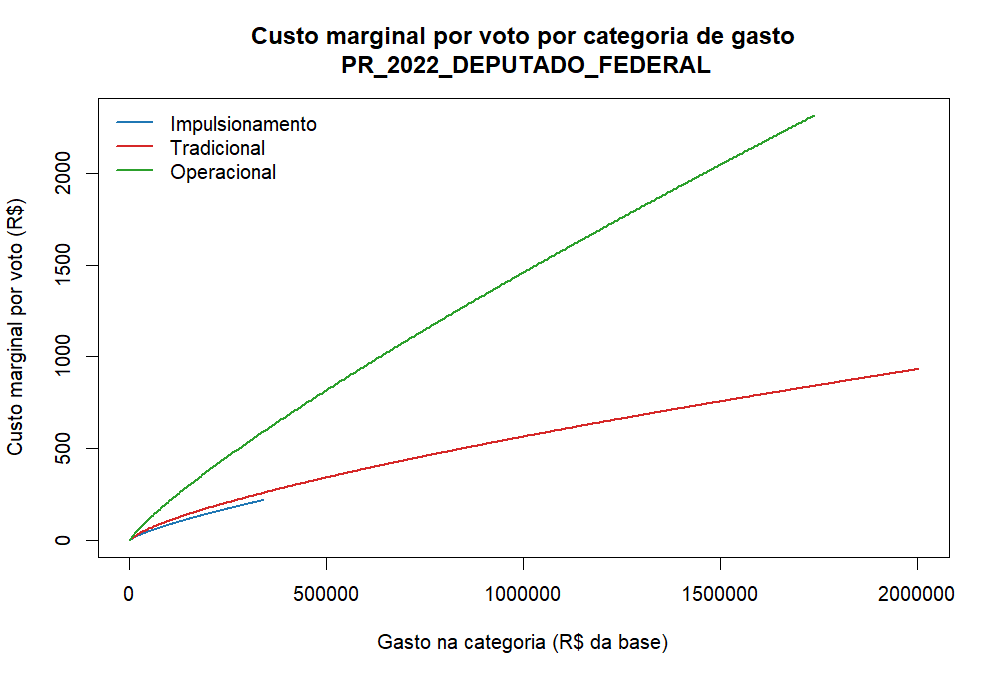

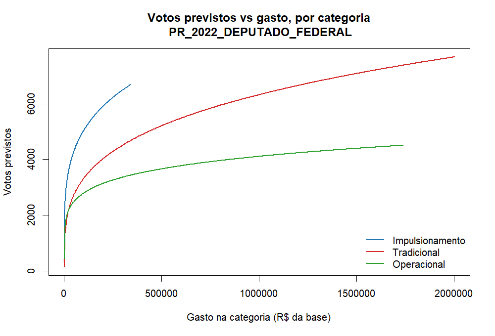

Limiar de custo por voto (media dos custos individuais): eleitos R$ 22; geral R$ 77.

| categoria | dose intensiva (b_lg) | n usuarios | saturacao (limiar eleitos) | saturacao (limiar geral) | faixa observada ate |
|---|---:|---:|---:|---:|---:|
| impulsionamento | 0,231 | 340 | R$ 17.406 | R$ 87.085 | R$ 338.414 |
| tradicional | 0,280 | 511 | R$ 11.312 | R$ 63.078 | R$ 2.000.625 |
| operacional | 0,167 | 546 | R$ 6.646 | R$ 29.367 | R$ 1.738.515 |

O ponto de saturacao e' o gasto na categoria a partir do qual cada voto
adicional custa mais do que o limiar (formula fechada na secao de metodo).
'Alem da faixa observada' significa que o cruzamento fica acima do quantil
99% do gasto observado dos usuarios, ou seja, e' extrapolacao.

---

## PR 2018, Deputado Estadual

Amostra do modelo de votos: n = 704 (de 767 candidatos; 54 eleitos). AIC = 12.332,0; theta (dispersao NB2) = 1,078. Gasto de referencia unico do cenario: R$ 7.533.

### Coeficientes completos

| termo | estimativa | EP | p | sig |
|---|---:|---:|---:|---|
| (Intercept) | 5,3394 | 0,1582 | 1,32e-249 | *** |
| usou_impulsionamento | -0,5321 | 0,3316 | 1,09e-01 |  |
| lg_impulsionamento | 0,1244 | 0,0416 | 2,77e-03 | ** |
| usou_tradicional | -2,1742 | 0,2863 | 3,11e-14 | *** |
| lg_tradicional | 0,3483 | 0,0318 | 6,7e-28 | *** |
| usou_operacional | -0,1177 | 0,1696 | 4,88e-01 |  |
| lg_operacional | 0,0630 | 0,0170 | 2,07e-04 | *** |
| reeleicao | 0,2231 | 0,2222 | 3,15e-01 |  |
| l_votos_mesmo_cargo_ultima | 0,0529 | 0,0153 | 5,47e-04 | *** |
| l_votos_prefeito_ultima | 0,0352 | 0,0226 | 1,18e-01 |  |
| l_votos_prefeito_penultima | 0,0209 | 0,0296 | 4,8e-01 |  |
| l_votos_vereador_ultima | -0,0070 | 0,0126 | 5,8e-01 |  |
| masculino | 1,0650 | 0,0853 | 8,58e-36 | *** |
| superior_completo | 0,4094 | 0,0822 | 6,39e-07 | *** |
| corbranca | -0,0803 | 0,1100 | 4,65e-01 |  |
| esquerda | 0,3109 | 0,0936 | 8,91e-04 | *** |
| direita | 0,4688 | 0,0909 | 2,48e-07 | *** |

### Leitura de cada variavel

- `usou_impulsionamento` (margem extensiva de impulsionamento): -0,532 pontos log ao passar de nao usar para usar a categoria; nao distinto de zero. Costuma ser negativo porque e' o intercepto de quem usa com dose proxima de zero; leia junto da dose e do efeito combinado.
- `lg_impulsionamento` (dose intensiva de impulsionamento, elasticidade entre usuarios): +1% de gasto associa-se a +0,124% de votos; distinto de zero a 1% (**). E' a inclinacao da curva de dose.
- `usou_tradicional` (margem extensiva de publicidade tradicional): -2,174 pontos log ao passar de nao usar para usar a categoria; distinto de zero a 0,1% (***). Costuma ser negativo porque e' o intercepto de quem usa com dose proxima de zero; leia junto da dose e do efeito combinado.
- `lg_tradicional` (dose intensiva de publicidade tradicional, elasticidade entre usuarios): +1% de gasto associa-se a +0,348% de votos; distinto de zero a 0,1% (***). E' a inclinacao da curva de dose.
- `usou_operacional` (margem extensiva de gasto operacional): -0,118 pontos log ao passar de nao usar para usar a categoria; nao distinto de zero. Costuma ser negativo porque e' o intercepto de quem usa com dose proxima de zero; leia junto da dose e do efeito combinado.
- `lg_operacional` (dose intensiva de gasto operacional, elasticidade entre usuarios): +1% de gasto associa-se a +0,063% de votos; distinto de zero a 0,1% (***). E' a inclinacao da curva de dose.
- `reeleicao`: ser incumbente associa-se a 25,0% nos votos esperados contra nao incumbente; nao distinto de zero. Ler junto de `l_votos_mesmo_cargo_ultima`: o efeito conjunto de incumbencia esta logo abaixo.
- `l_votos_mesmo_cargo_ultima` (elasticidade do capital politico: votacao do candidato para o mesmo cargo na eleicao anterior): +1% de votos naquela eleicao associa-se a +0,053% de votos agora; distinto de zero a 0,1% (***).
- `l_votos_prefeito_ultima` (elasticidade do capital politico: votacao para prefeito na ultima municipal): +1% de votos naquela eleicao associa-se a +0,035% de votos agora; nao distinto de zero.
- `l_votos_prefeito_penultima` (elasticidade do capital politico: votacao para prefeito na penultima municipal): +1% de votos naquela eleicao associa-se a +0,021% de votos agora; nao distinto de zero.
- `l_votos_vereador_ultima` (elasticidade do capital politico: votacao para vereador na ultima municipal): +1% de votos naquela eleicao associa-se a +-0,007% de votos agora; nao distinto de zero.
- `masculino`: 190,1% de votos (candidatos homens contra mulheres); distinto de zero a 0,1% (***).
- `superior_completo`: 50,6% de votos (superior completo contra sem superior completo); distinto de zero a 0,1% (***).
- `corbranca`: -7,7% de votos (autodeclarados brancos contra nao brancos); nao distinto de zero.
- `esquerda`: 36,5% de votos (partidos de esquerda contra o centro); distinto de zero a 0,1% (***).
- `direita`: 59,8% de votos (partidos de direita contra o centro); distinto de zero a 0,1% (***).
- EFEITO CONJUNTO DE INCUMBENCIA: um incumbente tipico (votacao anterior de 43.549 votos, mediana entre os 45 incumbentes da amostra) tem fator 2,20 de votos (120,0%) contra um desafiante sem historico; p = 8,2e-06 (***). E' a leitura correta de reeleicao + votacao anterior juntas.

### Efeito combinado das tres categorias (mesmo gasto de referencia, R$ 7.533)

| categoria | fator de votos | variacao | p | sig |
|---|---:|---:|---:|---|
| tradicional | 2,55 | 154,7% | 5,99e-15 | *** |
| impulsionamento | 1,78 | 78,3% | 8,29e-08 | *** |
| operacional | 1,56 | 56,0% | 4,22e-04 | *** |

No mesmo dinheiro (R$ 7.533), a ordem dos fatores de votos e': tradicional (2,55), impulsionamento (1,78), operacional (1,56). O fator compara um usuario tipico da categoria, naquele gasto, com um nao usuario.

### Comparacao com a especificacao da monografia

Mesma amostra e mesma familia NB2; muda a especificacao: a monografia usava
log1p do gasto unico por categoria e so a dummy de reeleicao como capital.

| medida | monografia | sig | atual | sig |
|---|---:|---|---:|---|
| elasticidade_impulsionamento (mono: log1p unico; atual: dose intensiva lg) | 0,0747 | *** | 0,1244 | ** |
| efeito_combinado_impulsionamento (fator de votos no gasto de referencia unico; so atual) | n/d |  | 1,7833 | *** |
| elasticidade_tradicional (mono: log1p unico; atual: dose intensiva lg) | 0,1175 | *** | 0,3483 | *** |
| efeito_combinado_tradicional (fator de votos no gasto de referencia unico; so atual) | n/d |  | 2,5467 | *** |
| elasticidade_operacional (mono: log1p unico; atual: dose intensiva lg) | 0,0875 | *** | 0,0630 | *** |
| efeito_combinado_operacional (fator de votos no gasto de referencia unico; so atual) | n/d |  | 1,5602 | *** |
| reeleicao | 1,1449 | *** | 0,2231 |  |
| l_votos_mesmo_cargo_ultima (so atual) | n/d |  | 0,0529 | *** |
| AIC | 12.416,7729 |  | 12.332,0108 |  |
| theta | 0,9659 |  | 1,0777 |  |

Leitura: a dose intensiva do impulsionamento entre usuarios (0,124) e' maior que a elasticidade log1p unica da monografia (0,075) porque o log1p unico dilui a dose entre os nao usuarios. A incumbencia, que na monografia era so a dummy de reeleicao (1,145), agora se reparte entre a dummy (0,223) e a votacao anterior do mesmo cargo, entao os dois termos atuais leem-se juntos (efeito conjunto acima). AIC: atual 12.332,0 contra 12.416,8 da monografia (o modelo atual ajusta melhor).

### Curvas comparativas e saturacao das tres categorias

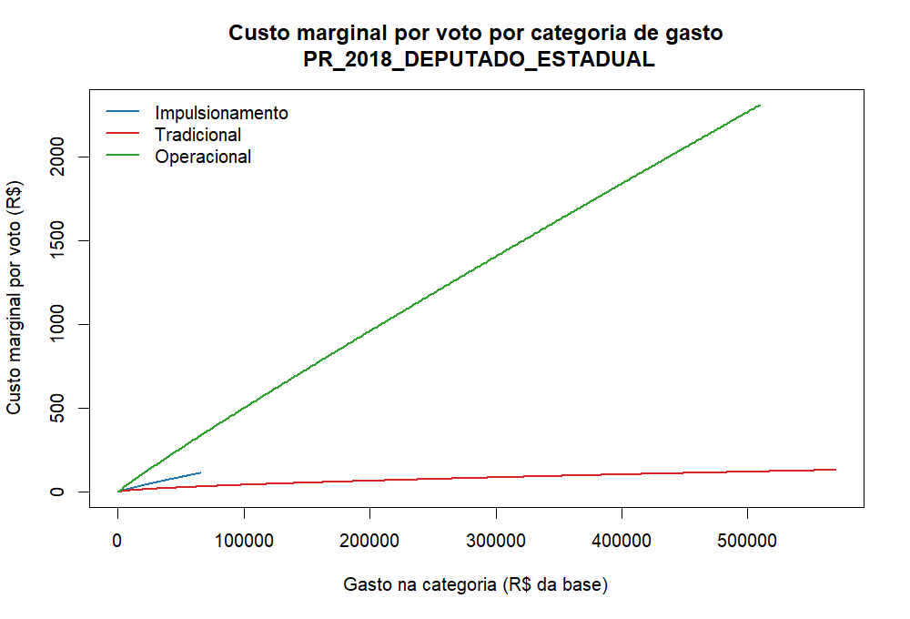

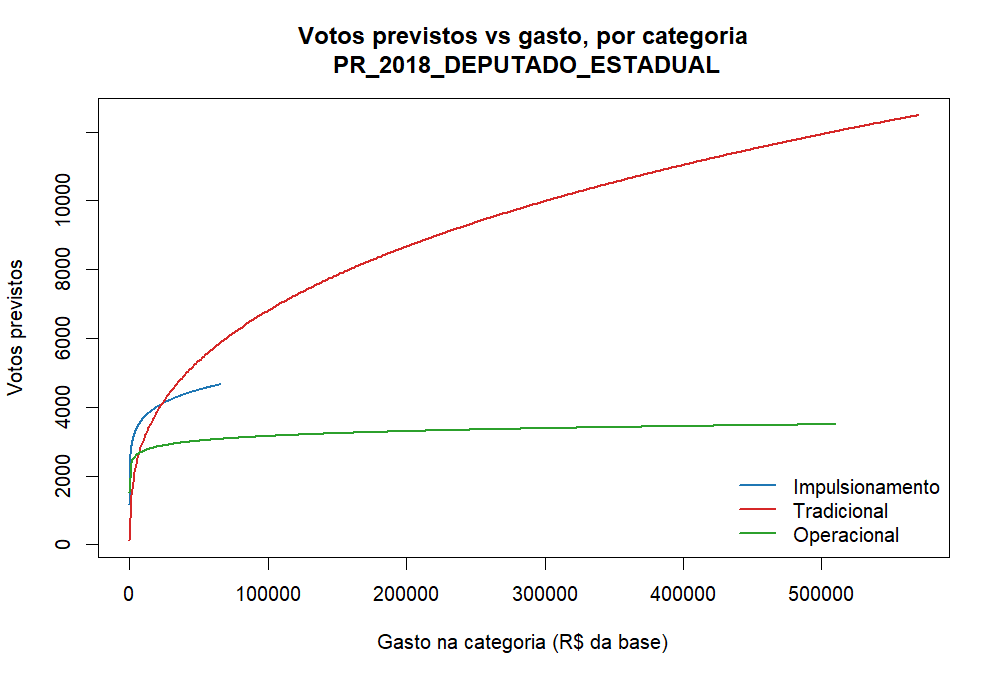

Limiar de custo por voto (media dos custos individuais): eleitos R$ 9; geral R$ 30.

| categoria | dose intensiva (b_lg) | n usuarios | saturacao (limiar eleitos) | saturacao (limiar geral) | faixa observada ate |
|---|---:|---:|---:|---:|---:|
| impulsionamento | 0,124 | 209 | R$ 3.653 | R$ 14.596 | R$ 65.467 |
| tradicional | 0,348 | 489 | R$ 9.394 | R$ 60.398 | R$ 569.611 |
| operacional | 0,063 | 495 | R$ 1.369 | R$ 4.996 | R$ 509.702 |

O ponto de saturacao e' o gasto na categoria a partir do qual cada voto
adicional custa mais do que o limiar (formula fechada na secao de metodo).
'Alem da faixa observada' significa que o cruzamento fica acima do quantil
99% do gasto observado dos usuarios, ou seja, e' extrapolacao.

---

## PR 2022, Deputado Estadual

Amostra do modelo de votos: n = 860 (de 902 candidatos; 54 eleitos). AIC = 14.541,8; theta (dispersao NB2) = 1,152. Gasto de referencia unico do cenario: R$ 10.038.

### Coeficientes completos

| termo | estimativa | EP | p | sig |
|---|---:|---:|---:|---|
| (Intercept) | 5,0959 | 0,1209 | 0e+00 | *** |
| usou_impulsionamento | -1,5655 | 0,2569 | 1,1e-09 | *** |
| lg_impulsionamento | 0,2602 | 0,0301 | 5,11e-18 | *** |
| usou_tradicional | -2,2977 | 0,2184 | 6,8e-26 | *** |
| lg_tradicional | 0,3373 | 0,0230 | 1,13e-48 | *** |
| usou_operacional | -0,8128 | 0,1598 | 3,62e-07 | *** |
| lg_operacional | 0,1208 | 0,0160 | 3,63e-14 | *** |
| reeleicao | 0,3893 | 0,2110 | 6,5e-02 | . |
| l_votos_mesmo_cargo_ultima | 0,0735 | 0,0144 | 3,53e-07 | *** |
| l_votos_prefeito_ultima | 0,0461 | 0,0160 | 3,93e-03 | ** |
| l_votos_prefeito_penultima | 0,0819 | 0,0200 | 4,27e-05 | *** |
| l_votos_vereador_ultima | 0,0100 | 0,0110 | 3,65e-01 |  |
| masculino | 0,7074 | 0,0711 | 2,39e-23 | *** |
| superior_completo | 0,4721 | 0,0698 | 1,38e-11 | *** |
| corbranca | 0,2240 | 0,0765 | 3,41e-03 | ** |
| esquerda | 0,1836 | 0,0887 | 3,85e-02 | * |
| direita | 0,0463 | 0,0754 | 5,39e-01 |  |

### Leitura de cada variavel

- `usou_impulsionamento` (margem extensiva de impulsionamento): -1,565 pontos log ao passar de nao usar para usar a categoria; distinto de zero a 0,1% (***). Costuma ser negativo porque e' o intercepto de quem usa com dose proxima de zero; leia junto da dose e do efeito combinado.
- `lg_impulsionamento` (dose intensiva de impulsionamento, elasticidade entre usuarios): +1% de gasto associa-se a +0,260% de votos; distinto de zero a 0,1% (***). E' a inclinacao da curva de dose.
- `usou_tradicional` (margem extensiva de publicidade tradicional): -2,298 pontos log ao passar de nao usar para usar a categoria; distinto de zero a 0,1% (***). Costuma ser negativo porque e' o intercepto de quem usa com dose proxima de zero; leia junto da dose e do efeito combinado.
- `lg_tradicional` (dose intensiva de publicidade tradicional, elasticidade entre usuarios): +1% de gasto associa-se a +0,337% de votos; distinto de zero a 0,1% (***). E' a inclinacao da curva de dose.
- `usou_operacional` (margem extensiva de gasto operacional): -0,813 pontos log ao passar de nao usar para usar a categoria; distinto de zero a 0,1% (***). Costuma ser negativo porque e' o intercepto de quem usa com dose proxima de zero; leia junto da dose e do efeito combinado.
- `lg_operacional` (dose intensiva de gasto operacional, elasticidade entre usuarios): +1% de gasto associa-se a +0,121% de votos; distinto de zero a 0,1% (***). E' a inclinacao da curva de dose.
- `reeleicao`: ser incumbente associa-se a 47,6% nos votos esperados contra nao incumbente; distinto de zero apenas a 10% (.). Ler junto de `l_votos_mesmo_cargo_ultima`: o efeito conjunto de incumbencia esta logo abaixo.
- `l_votos_mesmo_cargo_ultima` (elasticidade do capital politico: votacao do candidato para o mesmo cargo na eleicao anterior): +1% de votos naquela eleicao associa-se a +0,073% de votos agora; distinto de zero a 0,1% (***).
- `l_votos_prefeito_ultima` (elasticidade do capital politico: votacao para prefeito na ultima municipal): +1% de votos naquela eleicao associa-se a +0,046% de votos agora; distinto de zero a 1% (**).
- `l_votos_prefeito_penultima` (elasticidade do capital politico: votacao para prefeito na penultima municipal): +1% de votos naquela eleicao associa-se a +0,082% de votos agora; distinto de zero a 0,1% (***).
- `l_votos_vereador_ultima` (elasticidade do capital politico: votacao para vereador na ultima municipal): +1% de votos naquela eleicao associa-se a +0,010% de votos agora; nao distinto de zero.
- `masculino`: 102,9% de votos (candidatos homens contra mulheres); distinto de zero a 0,1% (***).
- `superior_completo`: 60,3% de votos (superior completo contra sem superior completo); distinto de zero a 0,1% (***).
- `corbranca`: 25,1% de votos (autodeclarados brancos contra nao brancos); distinto de zero a 1% (**).
- `esquerda`: 20,2% de votos (partidos de esquerda contra o centro); distinto de zero a 5% (*).
- `direita`: 4,7% de votos (partidos de direita contra o centro); nao distinto de zero.
- EFEITO CONJUNTO DE INCUMBENCIA: um incumbente tipico (votacao anterior de 39.535 votos, mediana entre os 44 incumbentes da amostra) tem fator 3,21 de votos (221,3%) contra um desafiante sem historico; p = 3,24e-13 (***). E' a leitura correta de reeleicao + votacao anterior juntas.

### Efeito combinado das tres categorias (mesmo gasto de referencia, R$ 10.038)

| categoria | fator de votos | variacao | p | sig |
|---|---:|---:|---:|---|
| impulsionamento | 2,30 | 129,7% | 2,15e-25 | *** |
| tradicional | 2,25 | 124,8% | 1,59e-18 | *** |
| operacional | 1,35 | 35,1% | 4,05e-03 | ** |

No mesmo dinheiro (R$ 10.038), a ordem dos fatores de votos e': impulsionamento (2,30), tradicional (2,25), operacional (1,35). O fator compara um usuario tipico da categoria, naquele gasto, com um nao usuario.

### Comparacao com a especificacao da monografia

Mesma amostra e mesma familia NB2; muda a especificacao: a monografia usava
log1p do gasto unico por categoria e so a dummy de reeleicao como capital.

| medida | monografia | sig | atual | sig |
|---|---:|---|---:|---|
| elasticidade_impulsionamento (mono: log1p unico; atual: dose intensiva lg) | 0,1183 | *** | 0,2602 | *** |
| efeito_combinado_impulsionamento (fator de votos no gasto de referencia unico; so atual) | n/d |  | 2,2973 | *** |
| elasticidade_tradicional (mono: log1p unico; atual: dose intensiva lg) | 0,1133 | *** | 0,3373 | *** |
| efeito_combinado_tradicional (fator de votos no gasto de referencia unico; so atual) | n/d |  | 2,2484 | *** |
| elasticidade_operacional (mono: log1p unico; atual: dose intensiva lg) | 0,0821 | *** | 0,1208 | *** |
| efeito_combinado_operacional (fator de votos no gasto de referencia unico; so atual) | n/d |  | 1,3506 | ** |
| reeleicao | 1,5981 | *** | 0,3893 | . |
| l_votos_mesmo_cargo_ultima (so atual) | n/d |  | 0,0735 | *** |
| AIC | 14.854,8658 |  | 14.541,8012 |  |
| theta | 0,8575 |  | 1,1522 |  |

Leitura: a dose intensiva do impulsionamento entre usuarios (0,260) e' maior que a elasticidade log1p unica da monografia (0,118) porque o log1p unico dilui a dose entre os nao usuarios. A incumbencia, que na monografia era so a dummy de reeleicao (1,598), agora se reparte entre a dummy (0,389) e a votacao anterior do mesmo cargo, entao os dois termos atuais leem-se juntos (efeito conjunto acima). AIC: atual 14.541,8 contra 14.854,9 da monografia (o modelo atual ajusta melhor).

### Curvas comparativas e saturacao das tres categorias

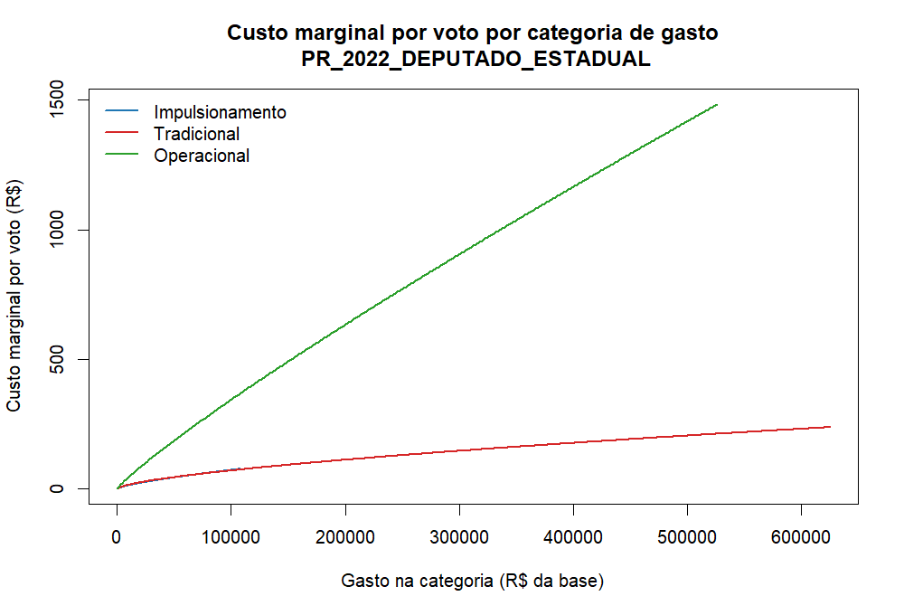

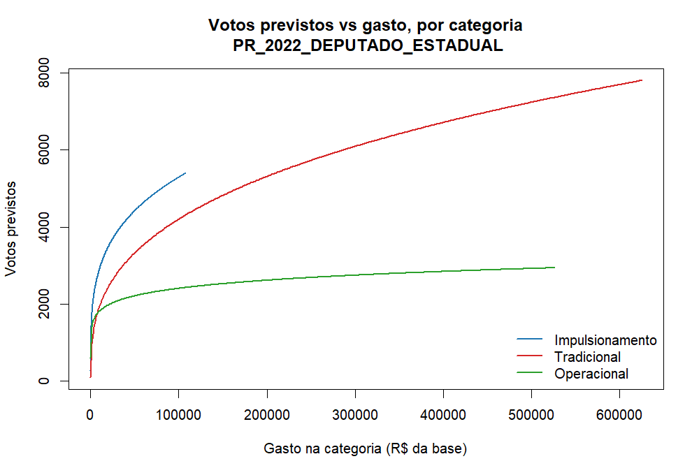

Limiar de custo por voto (media dos custos individuais): eleitos R$ 10; geral R$ 52.

| categoria | dose intensiva (b_lg) | n usuarios | saturacao (limiar eleitos) | saturacao (limiar geral) | faixa observada ate |
|---|---:|---:|---:|---:|---:|
| impulsionamento | 0,260 | 389 | R$ 6.725 | R$ 64.544 | R$ 107.868 |
| tradicional | 0,337 | 656 | R$ 5.133 | R$ 64.096 | R$ 625.201 |
| operacional | 0,121 | 713 | R$ 1.754 | R$ 11.766 | R$ 526.577 |

O ponto de saturacao e' o gasto na categoria a partir do qual cada voto
adicional custa mais do que o limiar (formula fechada na secao de metodo).
'Alem da faixa observada' significa que o cruzamento fica acima do quantil
99% do gasto observado dos usuarios, ou seja, e' extrapolacao.

---

## PR 2020, Vereador, porte PEQUENO

Amostra do modelo de votos: n = 16490 (de 17353 candidatos; 2790 eleitos). AIC = 174.429,4; theta (dispersao NB2) = 1,301. Gasto de referencia unico do cenario: R$ 595.

### Coeficientes completos

| termo | estimativa | EP | p | sig |
|---|---:|---:|---:|---|
| (Intercept) | 1,1408 | 0,1189 | 8,51e-22 | *** |
| usou_impulsionamento | -0,2168 | 0,4370 | 6,2e-01 |  |
| lg_impulsionamento | 0,0645 | 0,0734 | 3,79e-01 |  |
| usou_tradicional | -1,0713 | 0,0650 | 4,58e-61 | *** |
| lg_tradicional | 0,2385 | 0,0100 | 3,07e-125 | *** |
| usou_operacional | 0,0004 | 0,0414 | 9,92e-01 |  |
| lg_operacional | 0,0212 | 0,0062 | 6,17e-04 | *** |
| reeleicao | 0,1387 | 0,0328 | 2,39e-05 | *** |
| l_votos_mesmo_cargo_ultima | 0,1191 | 0,0034 | 7,7e-270 | *** |
| l_votos_deputado_ultima | -0,0827 | 0,0298 | 5,56e-03 | ** |
| masculino | 0,6058 | 0,0151 | 0e+00 | *** |
| superior_completo | 0,4908 | 0,0185 | 4,6e-155 | *** |
| corbranca | 0,1689 | 0,0158 | 1,08e-26 | *** |
| esquerda | -0,1041 | 0,0190 | 4,53e-08 | *** |
| direita | 0,0022 | 0,0155 | 8,88e-01 |  |
| l_apto | 0,2430 | 0,0135 | 6,86e-73 | *** |

### Leitura de cada variavel

- `usou_impulsionamento` (margem extensiva de impulsionamento): -0,217 pontos log ao passar de nao usar para usar a categoria; nao distinto de zero. Costuma ser negativo porque e' o intercepto de quem usa com dose proxima de zero; leia junto da dose e do efeito combinado.
- `lg_impulsionamento` (dose intensiva de impulsionamento, elasticidade entre usuarios): +1% de gasto associa-se a +0,064% de votos; nao distinto de zero. E' a inclinacao da curva de dose.
- `usou_tradicional` (margem extensiva de publicidade tradicional): -1,071 pontos log ao passar de nao usar para usar a categoria; distinto de zero a 0,1% (***). Costuma ser negativo porque e' o intercepto de quem usa com dose proxima de zero; leia junto da dose e do efeito combinado.
- `lg_tradicional` (dose intensiva de publicidade tradicional, elasticidade entre usuarios): +1% de gasto associa-se a +0,239% de votos; distinto de zero a 0,1% (***). E' a inclinacao da curva de dose.
- `usou_operacional` (margem extensiva de gasto operacional): 0,000 pontos log ao passar de nao usar para usar a categoria; nao distinto de zero. Costuma ser negativo porque e' o intercepto de quem usa com dose proxima de zero; leia junto da dose e do efeito combinado.
- `lg_operacional` (dose intensiva de gasto operacional, elasticidade entre usuarios): +1% de gasto associa-se a +0,021% de votos; distinto de zero a 0,1% (***). E' a inclinacao da curva de dose.
- `reeleicao`: ser incumbente associa-se a 14,9% nos votos esperados contra nao incumbente; distinto de zero a 0,1% (***). Ler junto de `l_votos_mesmo_cargo_ultima`: o efeito conjunto de incumbencia esta logo abaixo.
- `l_votos_mesmo_cargo_ultima` (elasticidade do capital politico: votacao do candidato para o mesmo cargo na eleicao anterior): +1% de votos naquela eleicao associa-se a +0,119% de votos agora; distinto de zero a 0,1% (***).
- `l_votos_deputado_ultima` (elasticidade do capital politico: votacao para deputado (federal ou estadual) na ultima geral): +1% de votos naquela eleicao associa-se a +-0,083% de votos agora; distinto de zero a 1% (**).
- `masculino`: 83,3% de votos (candidatos homens contra mulheres); distinto de zero a 0,1% (***).
- `superior_completo`: 63,4% de votos (superior completo contra sem superior completo); distinto de zero a 0,1% (***).
- `corbranca`: 18,4% de votos (autodeclarados brancos contra nao brancos); distinto de zero a 0,1% (***).
- `esquerda`: -9,9% de votos (partidos de esquerda contra o centro); distinto de zero a 0,1% (***).
- `direita`: 0,2% de votos (partidos de direita contra o centro); nao distinto de zero.
- `l_apto` (elasticidade do voto ao eleitorado apto do municipio): 0,243; entre 0 e 1 significa que o voto cresce menos que proporcional ao tamanho do municipio; distinto de zero a 0,1% (***).
- EFEITO CONJUNTO DE INCUMBENCIA: um incumbente tipico (votacao anterior de 234 votos, mediana entre os 922 incumbentes da amostra) tem fator 2,20 de votos (120,1%) contra um desafiante sem historico; p = 1,18e-150 (***). E' a leitura correta de reeleicao + votacao anterior juntas.

### Efeito combinado das tres categorias (mesmo gasto de referencia, R$ 595)

| categoria | fator de votos | variacao | p | sig |
|---|---:|---:|---:|---|
| tradicional | 1,57 | 57,3% | 1,4e-177 | *** |
| impulsionamento | 1,22 | 21,6% | 1,02e-02 | * |
| operacional | 1,15 | 14,6% | 7,54e-18 | *** |

No mesmo dinheiro (R$ 595), a ordem dos fatores de votos e': tradicional (1,57), impulsionamento (1,22), operacional (1,15). O fator compara um usuario tipico da categoria, naquele gasto, com um nao usuario.

### Comparacao com a especificacao da monografia

Mesma amostra e mesma familia NB2; muda a especificacao: a monografia usava
log1p do gasto unico por categoria e so a dummy de reeleicao como capital.

| medida | monografia | sig | atual | sig |
|---|---:|---|---:|---|
| elasticidade_impulsionamento (mono: log1p unico; atual: dose intensiva lg) | 0,0368 | ** | 0,0645 |  |
| efeito_combinado_impulsionamento (fator de votos no gasto de referencia unico; so atual) | n/d |  | 1,2155 | * |
| elasticidade_tradicional (mono: log1p unico; atual: dose intensiva lg) | 0,0820 | *** | 0,2385 | *** |
| efeito_combinado_tradicional (fator de votos no gasto de referencia unico; so atual) | n/d |  | 1,5725 | *** |
| elasticidade_operacional (mono: log1p unico; atual: dose intensiva lg) | 0,0232 | *** | 0,0212 | *** |
| efeito_combinado_operacional (fator de votos no gasto de referencia unico; so atual) | n/d |  | 1,1457 | *** |
| reeleicao | 0,6140 | *** | 0,1387 | *** |
| l_votos_mesmo_cargo_ultima (so atual) | n/d |  | 0,1191 | *** |
| AIC | 176.021,6373 |  | 174.429,3712 |  |
| theta | 1,1974 |  | 1,3010 |  |

Leitura: a dose intensiva do impulsionamento entre usuarios (0,064) e' maior que a elasticidade log1p unica da monografia (0,037) porque o log1p unico dilui a dose entre os nao usuarios. A incumbencia, que na monografia era so a dummy de reeleicao (0,614), agora se reparte entre a dummy (0,139) e a votacao anterior do mesmo cargo, entao os dois termos atuais leem-se juntos (efeito conjunto acima). AIC: atual 174.429,4 contra 176.021,6 da monografia (o modelo atual ajusta melhor).

### Curvas comparativas e saturacao das tres categorias

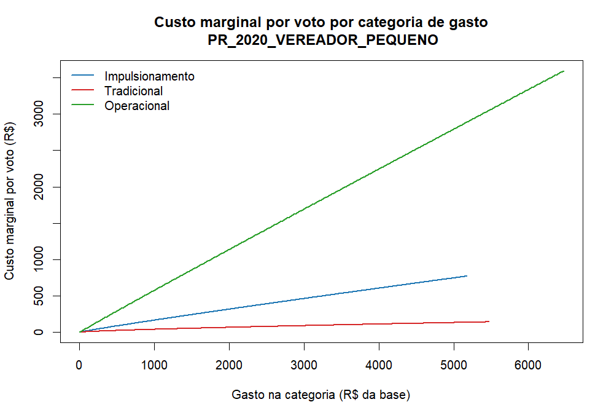

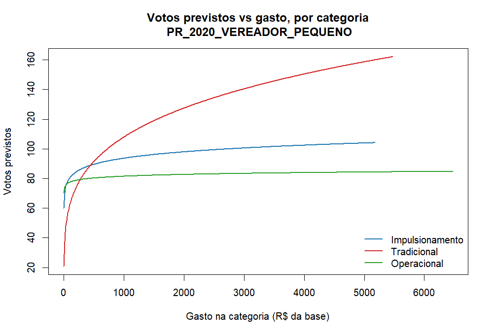

Limiar de custo por voto (media dos custos individuais): eleitos R$ 9; geral R$ 46.

| categoria | dose intensiva (b_lg) | n usuarios | saturacao (limiar eleitos) | saturacao (limiar geral) | faixa observada ate |
|---|---:|---:|---:|---:|---:|
| impulsionamento | 0,064 | 182 | n/d (dose intensiva nao distinta de zero a 5%) | n/d | R$ 5.176 |
| tradicional | 0,239 | 7738 | R$ 149 | R$ 1.235 | R$ 5.468 |
| operacional | 0,021 | 7534 | R$ 14 | R$ 75 | R$ 6.469 |

O ponto de saturacao e' o gasto na categoria a partir do qual cada voto
adicional custa mais do que o limiar (formula fechada na secao de metodo).
'Alem da faixa observada' significa que o cruzamento fica acima do quantil
99% do gasto observado dos usuarios, ou seja, e' extrapolacao.

---

## PR 2020, Vereador, porte MEDIO

Amostra do modelo de votos: n = 9322 (de 9836 candidatos; 767 eleitos). AIC = 107.864,6; theta (dispersao NB2) = 1,248. Gasto de referencia unico do cenario: R$ 828.

### Coeficientes completos

| termo | estimativa | EP | p | sig |
|---|---:|---:|---:|---|
| (Intercept) | 0,6150 | 0,2142 | 4,08e-03 | ** |
| usou_impulsionamento | 0,2297 | 0,2540 | 3,66e-01 |  |
| lg_impulsionamento | 0,0078 | 0,0401 | 8,47e-01 |  |
| usou_tradicional | -1,2150 | 0,0867 | 1,4e-44 | *** |
| lg_tradicional | 0,2627 | 0,0124 | 3,4e-99 | *** |
| usou_operacional | -0,0348 | 0,0473 | 4,62e-01 |  |
| lg_operacional | 0,0325 | 0,0067 | 1,08e-06 | *** |
| reeleicao | 0,2646 | 0,0572 | 3,77e-06 | *** |
| l_votos_mesmo_cargo_ultima | 0,1028 | 0,0041 | 2,39e-137 | *** |
| l_votos_deputado_ultima | -0,0026 | 0,0160 | 8,71e-01 |  |
| masculino | 0,5452 | 0,0203 | 3,59e-158 | *** |
| superior_completo | 0,4317 | 0,0224 | 1,59e-82 | *** |
| corbranca | 0,0359 | 0,0215 | 9,61e-02 | . |
| esquerda | -0,1195 | 0,0251 | 1,86e-06 | *** |
| direita | -0,0206 | 0,0212 | 3,31e-01 |  |
| l_apto | 0,3106 | 0,0207 | 6,03e-51 | *** |

### Leitura de cada variavel

- `usou_impulsionamento` (margem extensiva de impulsionamento): 0,230 pontos log ao passar de nao usar para usar a categoria; nao distinto de zero. Costuma ser negativo porque e' o intercepto de quem usa com dose proxima de zero; leia junto da dose e do efeito combinado.
- `lg_impulsionamento` (dose intensiva de impulsionamento, elasticidade entre usuarios): +1% de gasto associa-se a +0,008% de votos; nao distinto de zero. E' a inclinacao da curva de dose.
- `usou_tradicional` (margem extensiva de publicidade tradicional): -1,215 pontos log ao passar de nao usar para usar a categoria; distinto de zero a 0,1% (***). Costuma ser negativo porque e' o intercepto de quem usa com dose proxima de zero; leia junto da dose e do efeito combinado.
- `lg_tradicional` (dose intensiva de publicidade tradicional, elasticidade entre usuarios): +1% de gasto associa-se a +0,263% de votos; distinto de zero a 0,1% (***). E' a inclinacao da curva de dose.
- `usou_operacional` (margem extensiva de gasto operacional): -0,035 pontos log ao passar de nao usar para usar a categoria; nao distinto de zero. Costuma ser negativo porque e' o intercepto de quem usa com dose proxima de zero; leia junto da dose e do efeito combinado.
- `lg_operacional` (dose intensiva de gasto operacional, elasticidade entre usuarios): +1% de gasto associa-se a +0,033% de votos; distinto de zero a 0,1% (***). E' a inclinacao da curva de dose.
- `reeleicao`: ser incumbente associa-se a 30,3% nos votos esperados contra nao incumbente; distinto de zero a 0,1% (***). Ler junto de `l_votos_mesmo_cargo_ultima`: o efeito conjunto de incumbencia esta logo abaixo.
- `l_votos_mesmo_cargo_ultima` (elasticidade do capital politico: votacao do candidato para o mesmo cargo na eleicao anterior): +1% de votos naquela eleicao associa-se a +0,103% de votos agora; distinto de zero a 0,1% (***).
- `l_votos_deputado_ultima` (elasticidade do capital politico: votacao para deputado (federal ou estadual) na ultima geral): +1% de votos naquela eleicao associa-se a +-0,003% de votos agora; nao distinto de zero.
- `masculino`: 72,5% de votos (candidatos homens contra mulheres); distinto de zero a 0,1% (***).
- `superior_completo`: 54,0% de votos (superior completo contra sem superior completo); distinto de zero a 0,1% (***).
- `corbranca`: 3,7% de votos (autodeclarados brancos contra nao brancos); distinto de zero apenas a 10% (.).
- `esquerda`: -11,3% de votos (partidos de esquerda contra o centro); distinto de zero a 0,1% (***).
- `direita`: -2,0% de votos (partidos de direita contra o centro); nao distinto de zero.
- `l_apto` (elasticidade do voto ao eleitorado apto do municipio): 0,311; entre 0 e 1 significa que o voto cresce menos que proporcional ao tamanho do municipio; distinto de zero a 0,1% (***).
- EFEITO CONJUNTO DE INCUMBENCIA: um incumbente tipico (votacao anterior de 624 votos, mediana entre os 287 incumbentes da amostra) tem fator 2,53 de votos (152,6%) contra um desafiante sem historico; p = 7,32e-65 (***). E' a leitura correta de reeleicao + votacao anterior juntas.

### Efeito combinado das tres categorias (mesmo gasto de referencia, R$ 828)

| categoria | fator de votos | variacao | p | sig |
|---|---:|---:|---:|---|
| tradicional | 1,73 | 73,3% | 4,07e-137 | *** |
| impulsionamento | 1,33 | 32,6% | 3,22e-08 | *** |
| operacional | 1,20 | 20,2% | 1,67e-16 | *** |

No mesmo dinheiro (R$ 828), a ordem dos fatores de votos e': tradicional (1,73), impulsionamento (1,33), operacional (1,20). O fator compara um usuario tipico da categoria, naquele gasto, com um nao usuario.

### Comparacao com a especificacao da monografia

Mesma amostra e mesma familia NB2; muda a especificacao: a monografia usava
log1p do gasto unico por categoria e so a dummy de reeleicao como capital.

| medida | monografia | sig | atual | sig |
|---|---:|---|---:|---|
| elasticidade_impulsionamento (mono: log1p unico; atual: dose intensiva lg) | 0,0504 | *** | 0,0078 |  |
| efeito_combinado_impulsionamento (fator de votos no gasto de referencia unico; so atual) | n/d |  | 1,3256 | *** |
| elasticidade_tradicional (mono: log1p unico; atual: dose intensiva lg) | 0,0998 | *** | 0,2627 | *** |
| efeito_combinado_tradicional (fator de votos no gasto de referencia unico; so atual) | n/d |  | 1,7331 | *** |
| elasticidade_operacional (mono: log1p unico; atual: dose intensiva lg) | 0,0367 | *** | 0,0325 | *** |
| efeito_combinado_operacional (fator de votos no gasto de referencia unico; so atual) | n/d |  | 1,2017 | *** |
| reeleicao | 0,7799 | *** | 0,2646 | *** |
| l_votos_mesmo_cargo_ultima (so atual) | n/d |  | 0,1028 | *** |
| AIC | 108.777,2266 |  | 107.864,5539 |  |
| theta | 1,1496 |  | 1,2481 |  |

Leitura: a dose intensiva do impulsionamento entre usuarios (0,008) e' maior que a elasticidade log1p unica da monografia (0,050) porque o log1p unico dilui a dose entre os nao usuarios. A incumbencia, que na monografia era so a dummy de reeleicao (0,780), agora se reparte entre a dummy (0,265) e a votacao anterior do mesmo cargo, entao os dois termos atuais leem-se juntos (efeito conjunto acima). AIC: atual 107.864,6 contra 108.777,2 da monografia (o modelo atual ajusta melhor).

### Curvas comparativas e saturacao das tres categorias

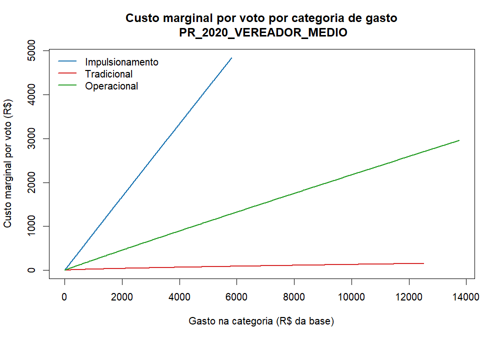

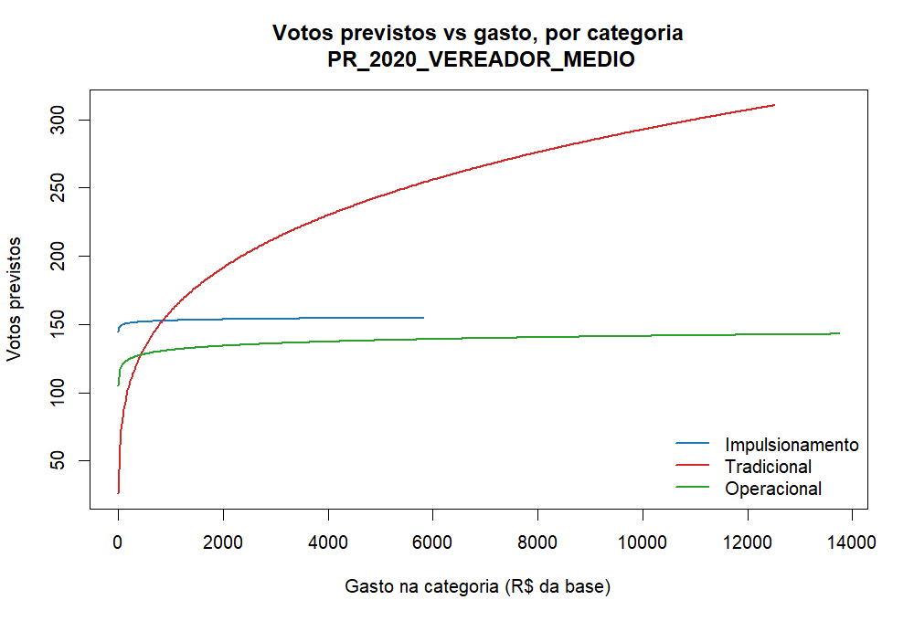

Limiar de custo por voto (media dos custos individuais): eleitos R$ 9; geral R$ 42.

| categoria | dose intensiva (b_lg) | n usuarios | saturacao (limiar eleitos) | saturacao (limiar geral) | faixa observada ate |
|---|---:|---:|---:|---:|---:|
| impulsionamento | 0,008 | 418 | n/d (dose intensiva nao distinta de zero a 5%) | n/d | R$ 5.823 |
| tradicional | 0,263 | 4439 | R$ 280 | R$ 2.155 | R$ 12.521 |
| operacional | 0,033 | 3981 | R$ 36 | R$ 169 | R$ 13.743 |

O ponto de saturacao e' o gasto na categoria a partir do qual cada voto
adicional custa mais do que o limiar (formula fechada na secao de metodo).
'Alem da faixa observada' significa que o cruzamento fica acima do quantil
99% do gasto observado dos usuarios, ou seja, e' extrapolacao.

---

## PR 2020, Vereador, porte GRANDE

Amostra do modelo de votos: n = 5509 (de 5950 candidatos; 274 eleitos). AIC = 68.995,6; theta (dispersao NB2) = 1,214. Gasto de referencia unico do cenario: R$ 1.370.

### Coeficientes completos

| termo | estimativa | EP | p | sig |
|---|---:|---:|---:|---|
| (Intercept) | 1,4213 | 0,2870 | 7,33e-07 | *** |
| usou_impulsionamento | -0,3100 | 0,1709 | 6,98e-02 | . |
| lg_impulsionamento | 0,1136 | 0,0248 | 4,7e-06 | *** |
| usou_tradicional | -1,1823 | 0,1127 | 9,74e-26 | *** |
| lg_tradicional | 0,2541 | 0,0147 | 2,85e-67 | *** |
| usou_operacional | 0,0863 | 0,0567 | 1,28e-01 |  |
| lg_operacional | 0,0118 | 0,0077 | 1,25e-01 |  |
| reeleicao | 0,1670 | 0,0887 | 5,98e-02 | . |
| l_votos_mesmo_cargo_ultima | 0,0975 | 0,0051 | 8,69e-81 | *** |
| l_votos_deputado_ultima | -0,0001 | 0,0097 | 9,88e-01 |  |
| masculino | 0,4346 | 0,0270 | 2,23e-58 | *** |
| superior_completo | 0,2630 | 0,0276 | 1,54e-21 | *** |
| corbranca | 0,0619 | 0,0272 | 2,31e-02 | * |
| esquerda | -0,3217 | 0,0334 | 5,26e-22 | *** |
| direita | 0,0002 | 0,0278 | 9,95e-01 |  |
| l_apto | 0,2376 | 0,0239 | 3,37e-23 | *** |

### Leitura de cada variavel

- `usou_impulsionamento` (margem extensiva de impulsionamento): -0,310 pontos log ao passar de nao usar para usar a categoria; distinto de zero apenas a 10% (.). Costuma ser negativo porque e' o intercepto de quem usa com dose proxima de zero; leia junto da dose e do efeito combinado.
- `lg_impulsionamento` (dose intensiva de impulsionamento, elasticidade entre usuarios): +1% de gasto associa-se a +0,114% de votos; distinto de zero a 0,1% (***). E' a inclinacao da curva de dose.
- `usou_tradicional` (margem extensiva de publicidade tradicional): -1,182 pontos log ao passar de nao usar para usar a categoria; distinto de zero a 0,1% (***). Costuma ser negativo porque e' o intercepto de quem usa com dose proxima de zero; leia junto da dose e do efeito combinado.
- `lg_tradicional` (dose intensiva de publicidade tradicional, elasticidade entre usuarios): +1% de gasto associa-se a +0,254% de votos; distinto de zero a 0,1% (***). E' a inclinacao da curva de dose.
- `usou_operacional` (margem extensiva de gasto operacional): 0,086 pontos log ao passar de nao usar para usar a categoria; nao distinto de zero. Costuma ser negativo porque e' o intercepto de quem usa com dose proxima de zero; leia junto da dose e do efeito combinado.
- `lg_operacional` (dose intensiva de gasto operacional, elasticidade entre usuarios): +1% de gasto associa-se a +0,012% de votos; nao distinto de zero. E' a inclinacao da curva de dose.
- `reeleicao`: ser incumbente associa-se a 18,2% nos votos esperados contra nao incumbente; distinto de zero apenas a 10% (.). Ler junto de `l_votos_mesmo_cargo_ultima`: o efeito conjunto de incumbencia esta logo abaixo.
- `l_votos_mesmo_cargo_ultima` (elasticidade do capital politico: votacao do candidato para o mesmo cargo na eleicao anterior): +1% de votos naquela eleicao associa-se a +0,098% de votos agora; distinto de zero a 0,1% (***).
- `l_votos_deputado_ultima` (elasticidade do capital politico: votacao para deputado (federal ou estadual) na ultima geral): +1% de votos naquela eleicao associa-se a +-0,000% de votos agora; nao distinto de zero.
- `masculino`: 54,4% de votos (candidatos homens contra mulheres); distinto de zero a 0,1% (***).
- `superior_completo`: 30,1% de votos (superior completo contra sem superior completo); distinto de zero a 0,1% (***).
- `corbranca`: 6,4% de votos (autodeclarados brancos contra nao brancos); distinto de zero a 5% (*).
- `esquerda`: -27,5% de votos (partidos de esquerda contra o centro); distinto de zero a 0,1% (***).
- `direita`: 0,0% de votos (partidos de direita contra o centro); nao distinto de zero.
- `l_apto` (elasticidade do voto ao eleitorado apto do municipio): 0,238; entre 0 e 1 significa que o voto cresce menos que proporcional ao tamanho do municipio; distinto de zero a 0,1% (***).
- EFEITO CONJUNTO DE INCUMBENCIA: um incumbente tipico (votacao anterior de 1.490 votos, mediana entre os 119 incumbentes da amostra) tem fator 2,41 de votos (141,0%) contra um desafiante sem historico; p = 1,63e-24 (***). E' a leitura correta de reeleicao + votacao anterior juntas.

### Efeito combinado das tres categorias (mesmo gasto de referencia, R$ 1.370)

| categoria | fator de votos | variacao | p | sig |
|---|---:|---:|---:|---|
| tradicional | 1,92 | 92,1% | 7,07e-99 | *** |
| impulsionamento | 1,67 | 66,6% | 1,39e-38 | *** |
| operacional | 1,19 | 18,8% | 1,14e-07 | *** |

No mesmo dinheiro (R$ 1.370), a ordem dos fatores de votos e': tradicional (1,92), impulsionamento (1,67), operacional (1,19). O fator compara um usuario tipico da categoria, naquele gasto, com um nao usuario.

### Comparacao com a especificacao da monografia

Mesma amostra e mesma familia NB2; muda a especificacao: a monografia usava
log1p do gasto unico por categoria e so a dummy de reeleicao como capital.

| medida | monografia | sig | atual | sig |
|---|---:|---|---:|---|
| elasticidade_impulsionamento (mono: log1p unico; atual: dose intensiva lg) | 0,0733 | *** | 0,1136 | *** |
| efeito_combinado_impulsionamento (fator de votos no gasto de referencia unico; so atual) | n/d |  | 1,6665 | *** |
| elasticidade_tradicional (mono: log1p unico; atual: dose intensiva lg) | 0,1180 | *** | 0,2541 | *** |
| efeito_combinado_tradicional (fator de votos no gasto de referencia unico; so atual) | n/d |  | 1,9206 | *** |
| elasticidade_operacional (mono: log1p unico; atual: dose intensiva lg) | 0,0320 | *** | 0,0118 |  |
| efeito_combinado_operacional (fator de votos no gasto de referencia unico; so atual) | n/d |  | 1,1875 | *** |
| reeleicao | 0,7612 | *** | 0,1670 | . |
| l_votos_mesmo_cargo_ultima (so atual) | n/d |  | 0,0975 | *** |
| AIC | 69.536,5602 |  | 68.995,5578 |  |
| theta | 1,1183 |  | 1,2139 |  |

Leitura: a dose intensiva do impulsionamento entre usuarios (0,114) e' maior que a elasticidade log1p unica da monografia (0,073) porque o log1p unico dilui a dose entre os nao usuarios. A incumbencia, que na monografia era so a dummy de reeleicao (0,761), agora se reparte entre a dummy (0,167) e a votacao anterior do mesmo cargo, entao os dois termos atuais leem-se juntos (efeito conjunto acima). AIC: atual 68.995,6 contra 69.536,6 da monografia (o modelo atual ajusta melhor).

### Curvas comparativas e saturacao das tres categorias

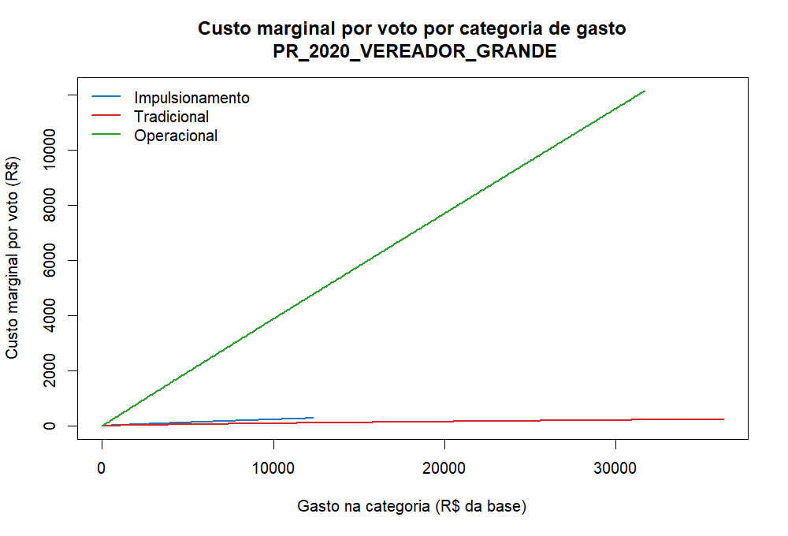

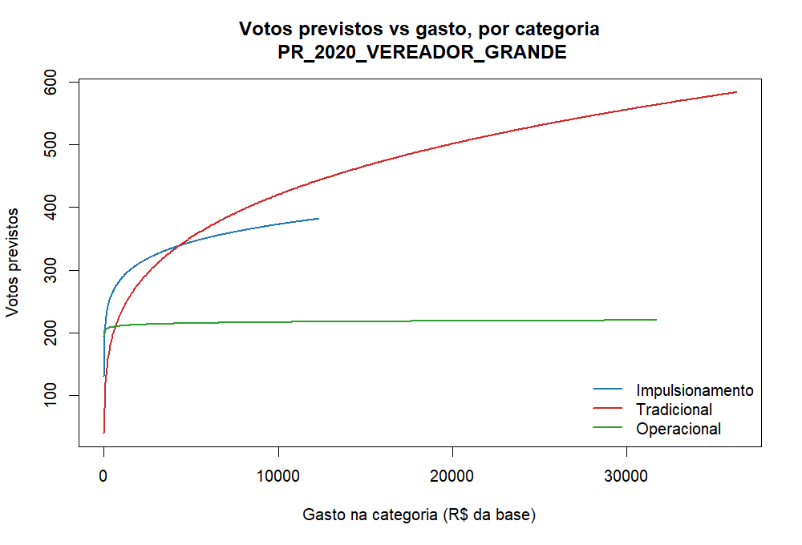

Limiar de custo por voto (media dos custos individuais): eleitos R$ 15; geral R$ 46.

| categoria | dose intensiva (b_lg) | n usuarios | saturacao (limiar eleitos) | saturacao (limiar geral) | faixa observada ate |
|---|---:|---:|---:|---:|---:|
| impulsionamento | 0,114 | 867 | R$ 432 | R$ 1.595 | R$ 12.329 |
| tradicional | 0,254 | 2681 | R$ 827 | R$ 3.896 | R$ 36.305 |
| operacional | 0,012 | 2481 | n/d (dose intensiva nao distinta de zero a 5%) | n/d | R$ 31.706 |

O ponto de saturacao e' o gasto na categoria a partir do qual cada voto
adicional custa mais do que o limiar (formula fechada na secao de metodo).
'Alem da faixa observada' significa que o cruzamento fica acima do quantil
99% do gasto observado dos usuarios, ou seja, e' extrapolacao.

---

## PR 2020, Vereador, porte METROPOLE

Amostra do modelo de votos: n = 1132 (de 1190 candidatos; 38 eleitos). AIC = 15.705,3; theta (dispersao NB2) = 1,282. Gasto de referencia unico do cenario: R$ 2.646.

### Coeficientes completos

| termo | estimativa | EP | p | sig |
|---|---:|---:|---:|---|
| (Intercept) | 4,7912 | 0,0828 | 0e+00 | *** |
| usou_impulsionamento | -0,5345 | 0,2240 | 1,7e-02 | * |
| lg_impulsionamento | 0,1520 | 0,0302 | 4,94e-07 | *** |
| usou_tradicional | -1,2433 | 0,2220 | 2,13e-08 | *** |
| lg_tradicional | 0,2621 | 0,0276 | 1,97e-21 | *** |
| usou_operacional | -0,1906 | 0,1185 | 1,08e-01 |  |
| lg_operacional | 0,0352 | 0,0147 | 1,69e-02 | * |
| reeleicao | 0,4184 | 0,2238 | 6,16e-02 | . |
| l_votos_mesmo_cargo_ultima | 0,0775 | 0,0105 | 1,95e-13 | *** |
| l_votos_deputado_ultima | 0,0006 | 0,0125 | 9,63e-01 |  |
| masculino | 0,3711 | 0,0585 | 2,25e-10 | *** |
| superior_completo | 0,1637 | 0,0567 | 3,91e-03 | ** |
| corbranca | -0,0811 | 0,0636 | 2,02e-01 |  |
| esquerda | -0,0231 | 0,0769 | 7,64e-01 |  |
| direita | 0,1566 | 0,0650 | 1,6e-02 | * |

### Leitura de cada variavel

- `usou_impulsionamento` (margem extensiva de impulsionamento): -0,534 pontos log ao passar de nao usar para usar a categoria; distinto de zero a 5% (*). Costuma ser negativo porque e' o intercepto de quem usa com dose proxima de zero; leia junto da dose e do efeito combinado.
- `lg_impulsionamento` (dose intensiva de impulsionamento, elasticidade entre usuarios): +1% de gasto associa-se a +0,152% de votos; distinto de zero a 0,1% (***). E' a inclinacao da curva de dose.
- `usou_tradicional` (margem extensiva de publicidade tradicional): -1,243 pontos log ao passar de nao usar para usar a categoria; distinto de zero a 0,1% (***). Costuma ser negativo porque e' o intercepto de quem usa com dose proxima de zero; leia junto da dose e do efeito combinado.
- `lg_tradicional` (dose intensiva de publicidade tradicional, elasticidade entre usuarios): +1% de gasto associa-se a +0,262% de votos; distinto de zero a 0,1% (***). E' a inclinacao da curva de dose.
- `usou_operacional` (margem extensiva de gasto operacional): -0,191 pontos log ao passar de nao usar para usar a categoria; nao distinto de zero. Costuma ser negativo porque e' o intercepto de quem usa com dose proxima de zero; leia junto da dose e do efeito combinado.
- `lg_operacional` (dose intensiva de gasto operacional, elasticidade entre usuarios): +1% de gasto associa-se a +0,035% de votos; distinto de zero a 5% (*). E' a inclinacao da curva de dose.
- `reeleicao`: ser incumbente associa-se a 52,0% nos votos esperados contra nao incumbente; distinto de zero apenas a 10% (.). Ler junto de `l_votos_mesmo_cargo_ultima`: o efeito conjunto de incumbencia esta logo abaixo.
- `l_votos_mesmo_cargo_ultima` (elasticidade do capital politico: votacao do candidato para o mesmo cargo na eleicao anterior): +1% de votos naquela eleicao associa-se a +0,077% de votos agora; distinto de zero a 0,1% (***).
- `l_votos_deputado_ultima` (elasticidade do capital politico: votacao para deputado (federal ou estadual) na ultima geral): +1% de votos naquela eleicao associa-se a +0,001% de votos agora; nao distinto de zero.
- `masculino`: 44,9% de votos (candidatos homens contra mulheres); distinto de zero a 0,1% (***).
- `superior_completo`: 17,8% de votos (superior completo contra sem superior completo); distinto de zero a 1% (**).
- `corbranca`: -7,8% de votos (autodeclarados brancos contra nao brancos); nao distinto de zero.
- `esquerda`: -2,3% de votos (partidos de esquerda contra o centro); nao distinto de zero.
- `direita`: 17,0% de votos (partidos de direita contra o centro); distinto de zero a 5% (*).
- EFEITO CONJUNTO DE INCUMBENCIA: um incumbente tipico (votacao anterior de 5.607 votos, mediana entre os 19 incumbentes da amostra) tem fator 2,97 de votos (196,6%) contra um desafiante sem historico; p = 8,67e-07 (***). E' a leitura correta de reeleicao + votacao anterior juntas.

### Efeito combinado das tres categorias (mesmo gasto de referencia, R$ 2.646)

| categoria | fator de votos | variacao | p | sig |
|---|---:|---:|---:|---|
| tradicional | 2,27 | 127,5% | 1,85e-31 | *** |
| impulsionamento | 1,94 | 94,1% | 2,31e-19 | *** |
| operacional | 1,09 | 9,1% | 2,49e-01 |  |

No mesmo dinheiro (R$ 2.646), a ordem dos fatores de votos e': tradicional (2,27), impulsionamento (1,94), operacional (1,09). O fator compara um usuario tipico da categoria, naquele gasto, com um nao usuario.

### Comparacao com a especificacao da monografia

Mesma amostra e mesma familia NB2; muda a especificacao: a monografia usava
log1p do gasto unico por categoria e so a dummy de reeleicao como capital.

| medida | monografia | sig | atual | sig |
|---|---:|---|---:|---|
| elasticidade_impulsionamento (mono: log1p unico; atual: dose intensiva lg) | 0,0947 | *** | 0,1520 | *** |
| efeito_combinado_impulsionamento (fator de votos no gasto de referencia unico; so atual) | n/d |  | 1,9409 | *** |
| elasticidade_tradicional (mono: log1p unico; atual: dose intensiva lg) | 0,1215 | *** | 0,2621 | *** |
| efeito_combinado_tradicional (fator de votos no gasto de referencia unico; so atual) | n/d |  | 2,2748 | *** |
| elasticidade_operacional (mono: log1p unico; atual: dose intensiva lg) | 0,0245 | * | 0,0352 | * |
| efeito_combinado_operacional (fator de votos no gasto de referencia unico; so atual) | n/d |  | 1,0907 |  |
| reeleicao | 1,1786 | *** | 0,4184 | . |
| l_votos_mesmo_cargo_ultima (so atual) | n/d |  | 0,0775 | *** |
| AIC | 15.829,3532 |  | 15.705,2870 |  |
| theta | 1,1634 |  | 1,2819 |  |

Leitura: a dose intensiva do impulsionamento entre usuarios (0,152) e' maior que a elasticidade log1p unica da monografia (0,095) porque o log1p unico dilui a dose entre os nao usuarios. A incumbencia, que na monografia era so a dummy de reeleicao (1,179), agora se reparte entre a dummy (0,418) e a votacao anterior do mesmo cargo, entao os dois termos atuais leem-se juntos (efeito conjunto acima). AIC: atual 15.705,3 contra 15.829,4 da monografia (o modelo atual ajusta melhor).

### Curvas comparativas e saturacao das tres categorias

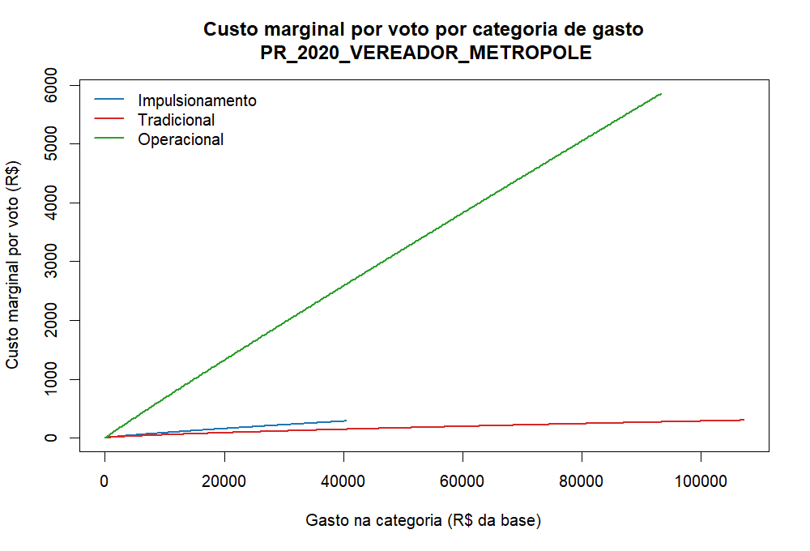

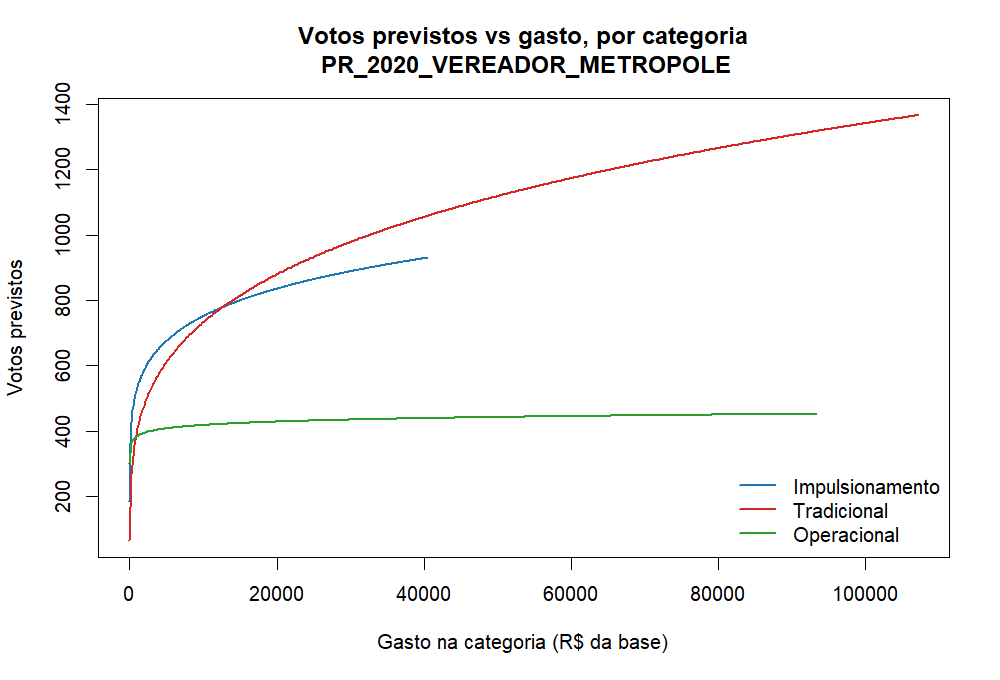

Limiar de custo por voto (media dos custos individuais): eleitos R$ 21; geral R$ 46.

| categoria | dose intensiva (b_lg) | n usuarios | saturacao (limiar eleitos) | saturacao (limiar geral) | faixa observada ate |
|---|---:|---:|---:|---:|---:|
| impulsionamento | 0,152 | 344 | R$ 1.865 | R$ 4.691 | R$ 40.410 |
| tradicional | 0,262 | 637 | R$ 2.938 | R$ 8.481 | R$ 107.149 |
| operacional | 0,035 | 673 | R$ 273 | R$ 615 | R$ 93.329 |

O ponto de saturacao e' o gasto na categoria a partir do qual cada voto
adicional custa mais do que o limiar (formula fechada na secao de metodo).
'Alem da faixa observada' significa que o cruzamento fica acima do quantil
99% do gasto observado dos usuarios, ou seja, e' extrapolacao.

---

## PR 2024, Vereador, porte PEQUENO

Amostra do modelo de votos: n = 16295 (de 16868 candidatos; 2752 eleitos). AIC = 174.759,7; theta (dispersao NB2) = 1,242. Gasto de referencia unico do cenario: R$ 995.

### Coeficientes completos

| termo | estimativa | EP | p | sig |
|---|---:|---:|---:|---|
| (Intercept) | 0,9630 | 0,1257 | 1,81e-14 | *** |
| usou_impulsionamento | -0,2238 | 0,2587 | 3,87e-01 |  |
| lg_impulsionamento | 0,0841 | 0,0419 | 4,44e-02 | * |
| usou_tradicional | -0,6745 | 0,0609 | 1,81e-28 | *** |
| lg_tradicional | 0,1608 | 0,0090 | 6,86e-72 | *** |
| usou_operacional | -0,1492 | 0,0588 | 1,11e-02 | * |
| lg_operacional | 0,0293 | 0,0082 | 3,55e-04 | *** |
| reeleicao | 0,4102 | 0,0271 | 6,82e-52 | *** |
| l_votos_mesmo_cargo_ultima | 0,1032 | 0,0036 | 2,62e-179 | *** |
| l_votos_deputado_ultima | -0,0000 | 0,0251 | 1e+00 |  |
| masculino | 0,5980 | 0,0155 | 0e+00 | *** |
| superior_completo | 0,5107 | 0,0181 | 8,67e-175 | *** |
| corbranca | 0,1763 | 0,0154 | 3,19e-30 | *** |
| esquerda | -0,2356 | 0,0205 | 1,29e-30 | *** |
| direita | 0,0238 | 0,0157 | 1,28e-01 |  |
| l_apto | 0,2729 | 0,0144 | 1,43e-80 | *** |

### Leitura de cada variavel

- `usou_impulsionamento` (margem extensiva de impulsionamento): -0,224 pontos log ao passar de nao usar para usar a categoria; nao distinto de zero. Costuma ser negativo porque e' o intercepto de quem usa com dose proxima de zero; leia junto da dose e do efeito combinado.
- `lg_impulsionamento` (dose intensiva de impulsionamento, elasticidade entre usuarios): +1% de gasto associa-se a +0,084% de votos; distinto de zero a 5% (*). E' a inclinacao da curva de dose.
- `usou_tradicional` (margem extensiva de publicidade tradicional): -0,674 pontos log ao passar de nao usar para usar a categoria; distinto de zero a 0,1% (***). Costuma ser negativo porque e' o intercepto de quem usa com dose proxima de zero; leia junto da dose e do efeito combinado.
- `lg_tradicional` (dose intensiva de publicidade tradicional, elasticidade entre usuarios): +1% de gasto associa-se a +0,161% de votos; distinto de zero a 0,1% (***). E' a inclinacao da curva de dose.
- `usou_operacional` (margem extensiva de gasto operacional): -0,149 pontos log ao passar de nao usar para usar a categoria; distinto de zero a 5% (*). Costuma ser negativo porque e' o intercepto de quem usa com dose proxima de zero; leia junto da dose e do efeito combinado.
- `lg_operacional` (dose intensiva de gasto operacional, elasticidade entre usuarios): +1% de gasto associa-se a +0,029% de votos; distinto de zero a 0,1% (***). E' a inclinacao da curva de dose.
- `reeleicao`: ser incumbente associa-se a 50,7% nos votos esperados contra nao incumbente; distinto de zero a 0,1% (***). Ler junto de `l_votos_mesmo_cargo_ultima`: o efeito conjunto de incumbencia esta logo abaixo.
- `l_votos_mesmo_cargo_ultima` (elasticidade do capital politico: votacao do candidato para o mesmo cargo na eleicao anterior): +1% de votos naquela eleicao associa-se a +0,103% de votos agora; distinto de zero a 0,1% (***).
- `l_votos_deputado_ultima` (elasticidade do capital politico: votacao para deputado (federal ou estadual) na ultima geral): +1% de votos naquela eleicao associa-se a +-0,000% de votos agora; nao distinto de zero.
- `masculino`: 81,8% de votos (candidatos homens contra mulheres); distinto de zero a 0,1% (***).
- `superior_completo`: 66,7% de votos (superior completo contra sem superior completo); distinto de zero a 0,1% (***).
- `corbranca`: 19,3% de votos (autodeclarados brancos contra nao brancos); distinto de zero a 0,1% (***).
- `esquerda`: -21,0% de votos (partidos de esquerda contra o centro); distinto de zero a 0,1% (***).
- `direita`: 2,4% de votos (partidos de direita contra o centro); nao distinto de zero.
- `l_apto` (elasticidade do voto ao eleitorado apto do municipio): 0,273; entre 0 e 1 significa que o voto cresce menos que proporcional ao tamanho do municipio; distinto de zero a 0,1% (***).
- EFEITO CONJUNTO DE INCUMBENCIA: um incumbente tipico (votacao anterior de 198 votos, mediana entre os 1603 incumbentes da amostra) tem fator 2,60 de votos (160,3%) contra um desafiante sem historico; p = 0e+00 (***). E' a leitura correta de reeleicao + votacao anterior juntas.

### Efeito combinado das tres categorias (mesmo gasto de referencia, R$ 995)

| categoria | fator de votos | variacao | p | sig |
|---|---:|---:|---:|---|
| tradicional | 1,55 | 54,6% | 7,62e-166 | *** |
| impulsionamento | 1,43 | 42,9% | 4,48e-08 | *** |
| operacional | 1,05 | 5,4% | 8,35e-04 | *** |

No mesmo dinheiro (R$ 995), a ordem dos fatores de votos e': tradicional (1,55), impulsionamento (1,43), operacional (1,05). O fator compara um usuario tipico da categoria, naquele gasto, com um nao usuario.

### Comparacao com a especificacao da monografia

Mesma amostra e mesma familia NB2; muda a especificacao: a monografia usava
log1p do gasto unico por categoria e so a dummy de reeleicao como capital.

| medida | monografia | sig | atual | sig |
|---|---:|---|---:|---|
| elasticidade_impulsionamento (mono: log1p unico; atual: dose intensiva lg) | 0,0530 | *** | 0,0841 | * |
| efeito_combinado_impulsionamento (fator de votos no gasto de referencia unico; so atual) | n/d |  | 1,4290 | *** |
| elasticidade_tradicional (mono: log1p unico; atual: dose intensiva lg) | 0,0655 | *** | 0,1608 | *** |
| efeito_combinado_tradicional (fator de votos no gasto de referencia unico; so atual) | n/d |  | 1,5456 | *** |
| elasticidade_operacional (mono: log1p unico; atual: dose intensiva lg) | 0,0097 | *** | 0,0293 | *** |
| efeito_combinado_operacional (fator de votos no gasto de referencia unico; so atual) | n/d |  | 1,0543 | *** |
| reeleicao | 0,7983 | *** | 0,4102 | *** |
| l_votos_mesmo_cargo_ultima (so atual) | n/d |  | 0,1032 | *** |
| AIC | 175.745,4784 |  | 174.759,6830 |  |
| theta | 1,1791 |  | 1,2415 |  |

Leitura: a dose intensiva do impulsionamento entre usuarios (0,084) e' maior que a elasticidade log1p unica da monografia (0,053) porque o log1p unico dilui a dose entre os nao usuarios. A incumbencia, que na monografia era so a dummy de reeleicao (0,798), agora se reparte entre a dummy (0,410) e a votacao anterior do mesmo cargo, entao os dois termos atuais leem-se juntos (efeito conjunto acima). AIC: atual 174.759,7 contra 175.745,5 da monografia (o modelo atual ajusta melhor).

### Curvas comparativas e saturacao das tres categorias

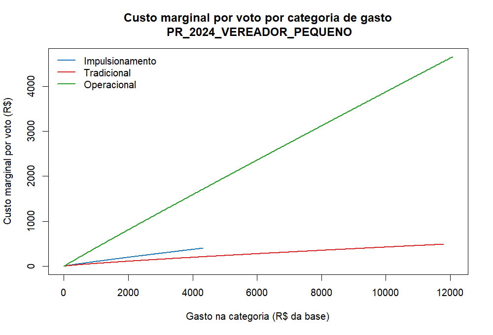

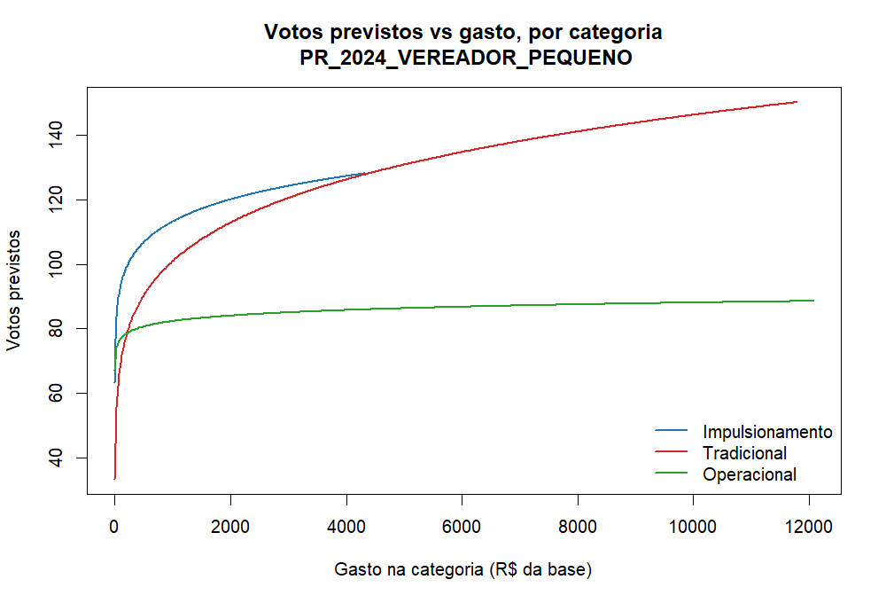

Limiar de custo por voto (media dos custos individuais): eleitos R$ 13; geral R$ 80.

| categoria | dose intensiva (b_lg) | n usuarios | saturacao (limiar eleitos) | saturacao (limiar geral) | faixa observada ate |
|---|---:|---:|---:|---:|---:|
| impulsionamento | 0,084 | 287 | R$ 103 | R$ 744 | R$ 4.314 |
| tradicional | 0,161 | 8139 | R$ 158 | R$ 1.368 | R$ 11.788 |
| operacional | 0,029 | 6142 | R$ 28 | R$ 184 | R$ 12.069 |

O ponto de saturacao e' o gasto na categoria a partir do qual cada voto
adicional custa mais do que o limiar (formula fechada na secao de metodo).
'Alem da faixa observada' significa que o cruzamento fica acima do quantil
99% do gasto observado dos usuarios, ou seja, e' extrapolacao.

---

## PR 2024, Vereador, porte MEDIO

Amostra do modelo de votos: n = 8797 (de 9174 candidatos; 802 eleitos). AIC = 103.458,9; theta (dispersao NB2) = 1,224. Gasto de referencia unico do cenario: R$ 1.362.

### Coeficientes completos

| termo | estimativa | EP | p | sig |
|---|---:|---:|---:|---|
| (Intercept) | 0,1067 | 0,2248 | 6,35e-01 |  |
| usou_impulsionamento | -0,1944 | 0,1628 | 2,32e-01 |  |
| lg_impulsionamento | 0,0828 | 0,0248 | 8,36e-04 | *** |
| usou_tradicional | -0,7783 | 0,0834 | 1,06e-20 | *** |
| lg_tradicional | 0,1912 | 0,0114 | 1,72e-63 | *** |
| usou_operacional | -0,1192 | 0,0607 | 4,97e-02 | * |
| lg_operacional | 0,0398 | 0,0081 | 8,53e-07 | *** |
| reeleicao | 0,5216 | 0,0432 | 1,5e-33 | *** |
| l_votos_mesmo_cargo_ultima | 0,1015 | 0,0043 | 3,7e-123 | *** |
| l_votos_deputado_ultima | 0,0101 | 0,0131 | 4,39e-01 |  |
| masculino | 0,5633 | 0,0210 | 3,36e-158 | *** |
| superior_completo | 0,4186 | 0,0225 | 2,34e-77 | *** |
| corbranca | 0,1033 | 0,0213 | 1,32e-06 | *** |
| esquerda | -0,1600 | 0,0273 | 4,41e-09 | *** |
| direita | 0,0812 | 0,0215 | 1,6e-04 | *** |
| l_apto | 0,3489 | 0,0217 | 4,12e-58 | *** |

### Leitura de cada variavel

- `usou_impulsionamento` (margem extensiva de impulsionamento): -0,194 pontos log ao passar de nao usar para usar a categoria; nao distinto de zero. Costuma ser negativo porque e' o intercepto de quem usa com dose proxima de zero; leia junto da dose e do efeito combinado.
- `lg_impulsionamento` (dose intensiva de impulsionamento, elasticidade entre usuarios): +1% de gasto associa-se a +0,083% de votos; distinto de zero a 0,1% (***). E' a inclinacao da curva de dose.
- `usou_tradicional` (margem extensiva de publicidade tradicional): -0,778 pontos log ao passar de nao usar para usar a categoria; distinto de zero a 0,1% (***). Costuma ser negativo porque e' o intercepto de quem usa com dose proxima de zero; leia junto da dose e do efeito combinado.
- `lg_tradicional` (dose intensiva de publicidade tradicional, elasticidade entre usuarios): +1% de gasto associa-se a +0,191% de votos; distinto de zero a 0,1% (***). E' a inclinacao da curva de dose.
- `usou_operacional` (margem extensiva de gasto operacional): -0,119 pontos log ao passar de nao usar para usar a categoria; distinto de zero a 5% (*). Costuma ser negativo porque e' o intercepto de quem usa com dose proxima de zero; leia junto da dose e do efeito combinado.
- `lg_operacional` (dose intensiva de gasto operacional, elasticidade entre usuarios): +1% de gasto associa-se a +0,040% de votos; distinto de zero a 0,1% (***). E' a inclinacao da curva de dose.
- `reeleicao`: ser incumbente associa-se a 68,5% nos votos esperados contra nao incumbente; distinto de zero a 0,1% (***). Ler junto de `l_votos_mesmo_cargo_ultima`: o efeito conjunto de incumbencia esta logo abaixo.
- `l_votos_mesmo_cargo_ultima` (elasticidade do capital politico: votacao do candidato para o mesmo cargo na eleicao anterior): +1% de votos naquela eleicao associa-se a +0,102% de votos agora; distinto de zero a 0,1% (***).
- `l_votos_deputado_ultima` (elasticidade do capital politico: votacao para deputado (federal ou estadual) na ultima geral): +1% de votos naquela eleicao associa-se a +0,010% de votos agora; nao distinto de zero.
- `masculino`: 75,6% de votos (candidatos homens contra mulheres); distinto de zero a 0,1% (***).
- `superior_completo`: 52,0% de votos (superior completo contra sem superior completo); distinto de zero a 0,1% (***).
- `corbranca`: 10,9% de votos (autodeclarados brancos contra nao brancos); distinto de zero a 0,1% (***).
- `esquerda`: -14,8% de votos (partidos de esquerda contra o centro); distinto de zero a 0,1% (***).
- `direita`: 8,5% de votos (partidos de direita contra o centro); distinto de zero a 0,1% (***).
- `l_apto` (elasticidade do voto ao eleitorado apto do municipio): 0,349; entre 0 e 1 significa que o voto cresce menos que proporcional ao tamanho do municipio; distinto de zero a 0,1% (***).
- EFEITO CONJUNTO DE INCUMBENCIA: um incumbente tipico (votacao anterior de 523 votos, mediana entre os 538 incumbentes da amostra) tem fator 3,18 de votos (218,2%) contra um desafiante sem historico; p = 1,68e-181 (***). E' a leitura correta de reeleicao + votacao anterior juntas.

### Efeito combinado das tres categorias (mesmo gasto de referencia, R$ 1.362)

| categoria | fator de votos | variacao | p | sig |
|---|---:|---:|---:|---|
| tradicional | 1,83 | 82,5% | 3,82e-168 | *** |
| impulsionamento | 1,50 | 49,7% | 3,53e-24 | *** |
| operacional | 1,18 | 18,3% | 2,02e-14 | *** |

No mesmo dinheiro (R$ 1.362), a ordem dos fatores de votos e': tradicional (1,83), impulsionamento (1,50), operacional (1,18). O fator compara um usuario tipico da categoria, naquele gasto, com um nao usuario.

### Comparacao com a especificacao da monografia

Mesma amostra e mesma familia NB2; muda a especificacao: a monografia usava
log1p do gasto unico por categoria e so a dummy de reeleicao como capital.

| medida | monografia | sig | atual | sig |
|---|---:|---|---:|---|
| elasticidade_impulsionamento (mono: log1p unico; atual: dose intensiva lg) | 0,0604 | *** | 0,0828 | *** |
| efeito_combinado_impulsionamento (fator de votos no gasto de referencia unico; so atual) | n/d |  | 1,4965 | *** |
| elasticidade_tradicional (mono: log1p unico; atual: dose intensiva lg) | 0,0909 | *** | 0,1912 | *** |
| efeito_combinado_tradicional (fator de votos no gasto de referencia unico; so atual) | n/d |  | 1,8251 | *** |
| elasticidade_operacional (mono: log1p unico; atual: dose intensiva lg) | 0,0276 | *** | 0,0398 | *** |
| efeito_combinado_operacional (fator de votos no gasto de referencia unico; so atual) | n/d |  | 1,1830 | *** |
| reeleicao | 0,9681 | *** | 0,5216 | *** |
| l_votos_mesmo_cargo_ultima (so atual) | n/d |  | 0,1015 | *** |
| AIC | 104.142,3819 |  | 103.458,9168 |  |
| theta | 1,1470 |  | 1,2241 |  |

Leitura: a dose intensiva do impulsionamento entre usuarios (0,083) e' maior que a elasticidade log1p unica da monografia (0,060) porque o log1p unico dilui a dose entre os nao usuarios. A incumbencia, que na monografia era so a dummy de reeleicao (0,968), agora se reparte entre a dummy (0,522) e a votacao anterior do mesmo cargo, entao os dois termos atuais leem-se juntos (efeito conjunto acima). AIC: atual 103.458,9 contra 104.142,4 da monografia (o modelo atual ajusta melhor).

### Curvas comparativas e saturacao das tres categorias

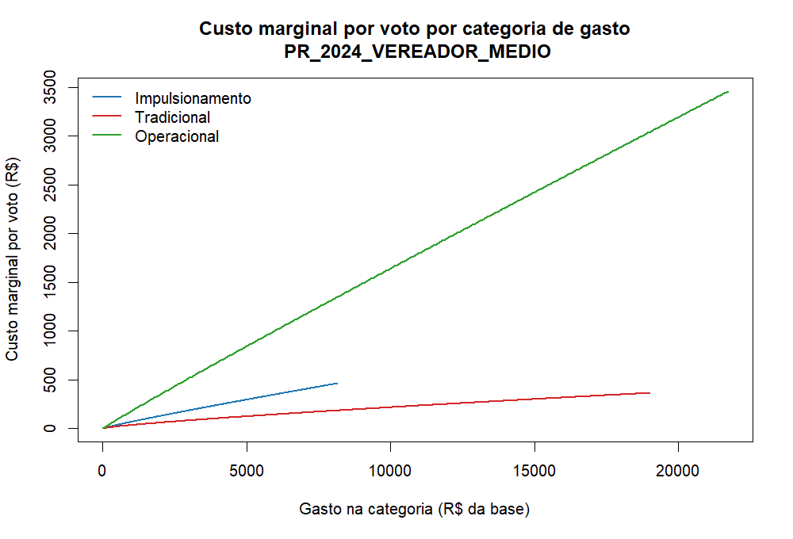

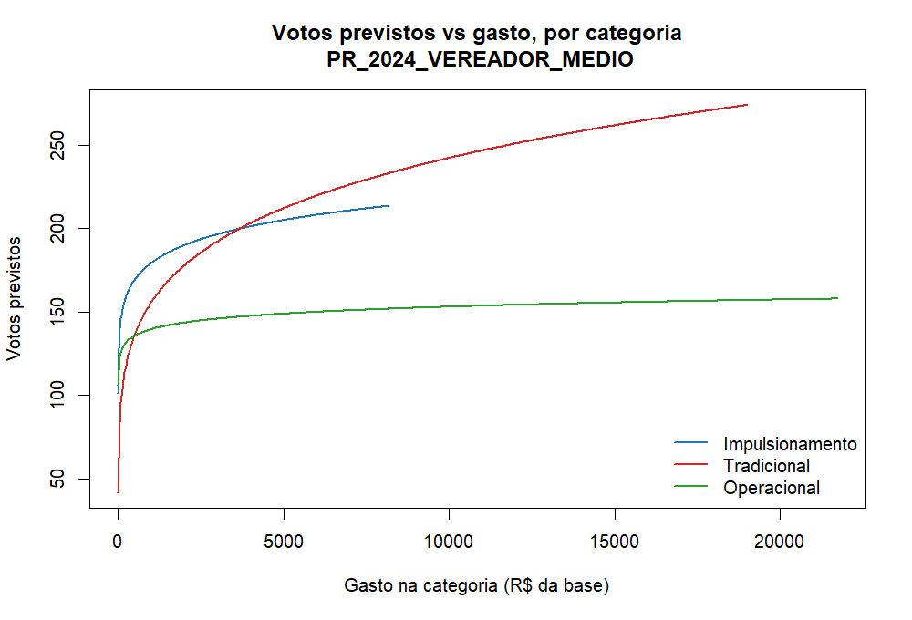

Limiar de custo por voto (media dos custos individuais): eleitos R$ 12; geral R$ 65.

| categoria | dose intensiva (b_lg) | n usuarios | saturacao (limiar eleitos) | saturacao (limiar geral) | faixa observada ate |
|---|---:|---:|---:|---:|---:|
| impulsionamento | 0,083 | 868 | R$ 154 | R$ 964 | R$ 8.155 |
| tradicional | 0,191 | 4888 | R$ 283 | R$ 2.272 | R$ 19.007 |
| operacional | 0,040 | 3448 | R$ 60 | R$ 347 | R$ 21.725 |

O ponto de saturacao e' o gasto na categoria a partir do qual cada voto
adicional custa mais do que o limiar (formula fechada na secao de metodo).
'Alem da faixa observada' significa que o cruzamento fica acima do quantil
99% do gasto observado dos usuarios, ou seja, e' extrapolacao.

---

## PR 2024, Vereador, porte GRANDE

Amostra do modelo de votos: n = 4710 (de 4925 candidatos; 313 eleitos). AIC = 61.538,8; theta (dispersao NB2) = 1,318. Gasto de referencia unico do cenario: R$ 2.500.

### Coeficientes completos

| termo | estimativa | EP | p | sig |
|---|---:|---:|---:|---|
| (Intercept) | 1,9849 | 0,3062 | 9e-11 | *** |
| usou_impulsionamento | -0,3730 | 0,1230 | 2,44e-03 | ** |
| lg_impulsionamento | 0,1108 | 0,0174 | 1,81e-10 | *** |
| usou_tradicional | -0,8160 | 0,1053 | 9,38e-15 | *** |
| lg_tradicional | 0,2021 | 0,0131 | 2,28e-53 | *** |
| usou_operacional | -0,0806 | 0,0774 | 2,97e-01 |  |
| lg_operacional | 0,0328 | 0,0098 | 8,32e-04 | *** |
| reeleicao | 0,4442 | 0,0624 | 1,06e-12 | *** |
| l_votos_mesmo_cargo_ultima | 0,0913 | 0,0050 | 8,17e-75 | *** |
| l_votos_deputado_ultima | 0,0244 | 0,0083 | 3,19e-03 | ** |
| masculino | 0,6060 | 0,0279 | 1,81e-104 | *** |
| superior_completo | 0,2750 | 0,0279 | 6,07e-23 | *** |
| corbranca | 0,0464 | 0,0277 | 9,33e-02 | . |
| esquerda | -0,1842 | 0,0355 | 2,14e-07 | *** |
| direita | 0,0950 | 0,0286 | 8,98e-04 | *** |
| l_apto | 0,1798 | 0,0257 | 2,55e-12 | *** |

### Leitura de cada variavel

- `usou_impulsionamento` (margem extensiva de impulsionamento): -0,373 pontos log ao passar de nao usar para usar a categoria; distinto de zero a 1% (**). Costuma ser negativo porque e' o intercepto de quem usa com dose proxima de zero; leia junto da dose e do efeito combinado.
- `lg_impulsionamento` (dose intensiva de impulsionamento, elasticidade entre usuarios): +1% de gasto associa-se a +0,111% de votos; distinto de zero a 0,1% (***). E' a inclinacao da curva de dose.
- `usou_tradicional` (margem extensiva de publicidade tradicional): -0,816 pontos log ao passar de nao usar para usar a categoria; distinto de zero a 0,1% (***). Costuma ser negativo porque e' o intercepto de quem usa com dose proxima de zero; leia junto da dose e do efeito combinado.
- `lg_tradicional` (dose intensiva de publicidade tradicional, elasticidade entre usuarios): +1% de gasto associa-se a +0,202% de votos; distinto de zero a 0,1% (***). E' a inclinacao da curva de dose.
- `usou_operacional` (margem extensiva de gasto operacional): -0,081 pontos log ao passar de nao usar para usar a categoria; nao distinto de zero. Costuma ser negativo porque e' o intercepto de quem usa com dose proxima de zero; leia junto da dose e do efeito combinado.
- `lg_operacional` (dose intensiva de gasto operacional, elasticidade entre usuarios): +1% de gasto associa-se a +0,033% de votos; distinto de zero a 0,1% (***). E' a inclinacao da curva de dose.
- `reeleicao`: ser incumbente associa-se a 55,9% nos votos esperados contra nao incumbente; distinto de zero a 0,1% (***). Ler junto de `l_votos_mesmo_cargo_ultima`: o efeito conjunto de incumbencia esta logo abaixo.
- `l_votos_mesmo_cargo_ultima` (elasticidade do capital politico: votacao do candidato para o mesmo cargo na eleicao anterior): +1% de votos naquela eleicao associa-se a +0,091% de votos agora; distinto de zero a 0,1% (***).
- `l_votos_deputado_ultima` (elasticidade do capital politico: votacao para deputado (federal ou estadual) na ultima geral): +1% de votos naquela eleicao associa-se a +0,024% de votos agora; distinto de zero a 1% (**).
- `masculino`: 83,3% de votos (candidatos homens contra mulheres); distinto de zero a 0,1% (***).
- `superior_completo`: 31,7% de votos (superior completo contra sem superior completo); distinto de zero a 0,1% (***).
- `corbranca`: 4,8% de votos (autodeclarados brancos contra nao brancos); distinto de zero apenas a 10% (.).
- `esquerda`: -16,8% de votos (partidos de esquerda contra o centro); distinto de zero a 0,1% (***).
- `direita`: 10,0% de votos (partidos de direita contra o centro); distinto de zero a 0,1% (***).
- `l_apto` (elasticidade do voto ao eleitorado apto do municipio): 0,180; entre 0 e 1 significa que o voto cresce menos que proporcional ao tamanho do municipio; distinto de zero a 0,1% (***).
- EFEITO CONJUNTO DE INCUMBENCIA: um incumbente tipico (votacao anterior de 1.148 votos, mediana entre os 223 incumbentes da amostra) tem fator 2,97 de votos (196,6%) contra um desafiante sem historico; p = 1,04e-71 (***). E' a leitura correta de reeleicao + votacao anterior juntas.

### Efeito combinado das tres categorias (mesmo gasto de referencia, R$ 2.500)

| categoria | fator de votos | variacao | p | sig |
|---|---:|---:|---:|---|
| tradicional | 2,15 | 114,9% | 5,17e-146 | *** |
| impulsionamento | 1,64 | 63,8% | 1,07e-42 | *** |
| operacional | 1,19 | 19,3% | 1,65e-09 | *** |

No mesmo dinheiro (R$ 2.500), a ordem dos fatores de votos e': tradicional (2,15), impulsionamento (1,64), operacional (1,19). O fator compara um usuario tipico da categoria, naquele gasto, com um nao usuario.

### Comparacao com a especificacao da monografia

Mesma amostra e mesma familia NB2; muda a especificacao: a monografia usava
log1p do gasto unico por categoria e so a dummy de reeleicao como capital.

| medida | monografia | sig | atual | sig |
|---|---:|---|---:|---|
| elasticidade_impulsionamento (mono: log1p unico; atual: dose intensiva lg) | 0,0718 | *** | 0,1108 | *** |
| efeito_combinado_impulsionamento (fator de votos no gasto de referencia unico; so atual) | n/d |  | 1,6385 | *** |
| elasticidade_tradicional (mono: log1p unico; atual: dose intensiva lg) | 0,1105 | *** | 0,2021 | *** |
| efeito_combinado_tradicional (fator de votos no gasto de referencia unico; so atual) | n/d |  | 2,1491 | *** |
| elasticidade_operacional (mono: log1p unico; atual: dose intensiva lg) | 0,0327 | *** | 0,0328 | *** |
| efeito_combinado_operacional (fator de votos no gasto de referencia unico; so atual) | n/d |  | 1,1929 | *** |
| reeleicao | 0,9138 | *** | 0,4442 | *** |
| l_votos_mesmo_cargo_ultima (so atual) | n/d |  | 0,0913 | *** |
| AIC | 62.007,9177 |  | 61.538,7760 |  |
| theta | 1,2117 |  | 1,3179 |  |

Leitura: a dose intensiva do impulsionamento entre usuarios (0,111) e' maior que a elasticidade log1p unica da monografia (0,072) porque o log1p unico dilui a dose entre os nao usuarios. A incumbencia, que na monografia era so a dummy de reeleicao (0,914), agora se reparte entre a dummy (0,444) e a votacao anterior do mesmo cargo, entao os dois termos atuais leem-se juntos (efeito conjunto acima). AIC: atual 61.538,8 contra 62.007,9 da monografia (o modelo atual ajusta melhor).

### Curvas comparativas e saturacao das tres categorias

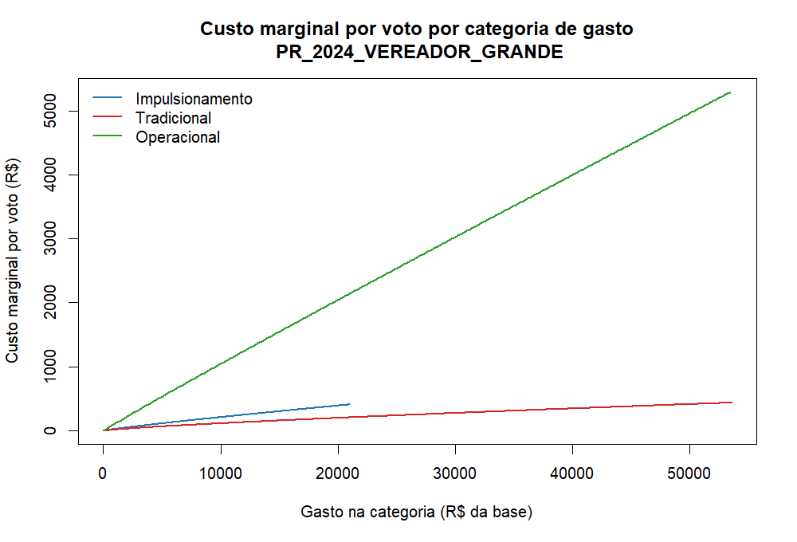

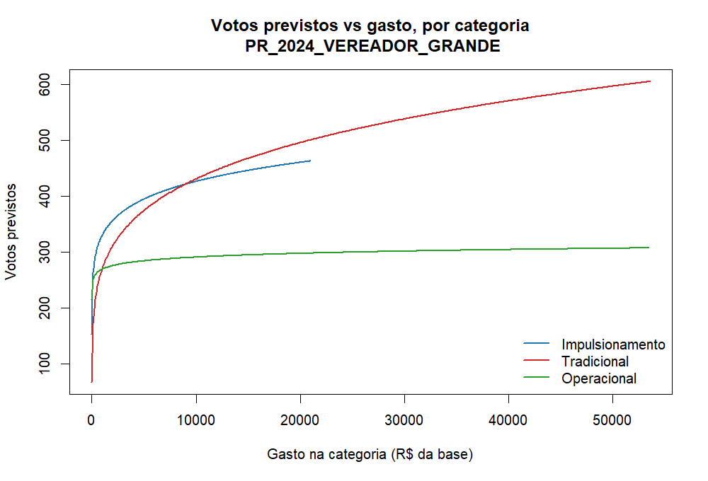

Limiar de custo por voto (media dos custos individuais): eleitos R$ 16; geral R$ 58.

| categoria | dose intensiva (b_lg) | n usuarios | saturacao (limiar eleitos) | saturacao (limiar geral) | faixa observada ate |
|---|---:|---:|---:|---:|---:|
| impulsionamento | 0,111 | 1337 | R$ 551 | R$ 2.346 | R$ 20.969 |
| tradicional | 0,202 | 2902 | R$ 851 | R$ 4.279 | R$ 53.553 |
| operacional | 0,033 | 2096 | R$ 133 | R$ 505 | R$ 53.464 |

O ponto de saturacao e' o gasto na categoria a partir do qual cada voto
adicional custa mais do que o limiar (formula fechada na secao de metodo).
'Alem da faixa observada' significa que o cruzamento fica acima do quantil
99% do gasto observado dos usuarios, ou seja, e' extrapolacao.

---

## PR 2024, Vereador, porte METROPOLE

Amostra do modelo de votos: n = 732 (de 752 candidatos; 38 eleitos). AIC = 10.889,9; theta (dispersao NB2) = 1,269. Gasto de referencia unico do cenario: R$ 5.952.

### Coeficientes completos

| termo | estimativa | EP | p | sig |
|---|---:|---:|---:|---|
| (Intercept) | 4,9487 | 0,1124 | 0e+00 | *** |
| usou_impulsionamento | -1,4549 | 0,2070 | 2,09e-12 | *** |
| lg_impulsionamento | 0,2752 | 0,0255 | 3e-27 | *** |
| usou_tradicional | -1,0406 | 0,2265 | 4,35e-06 | *** |
| lg_tradicional | 0,2189 | 0,0276 | 2,15e-15 | *** |
| usou_operacional | -0,5212 | 0,1911 | 6,39e-03 | ** |
| lg_operacional | 0,0626 | 0,0214 | 3,46e-03 | ** |
| reeleicao | 0,1331 | 0,1717 | 4,38e-01 |  |
| l_votos_mesmo_cargo_ultima | 0,0557 | 0,0125 | 8,87e-06 | *** |
| l_votos_deputado_ultima | 0,0088 | 0,0121 | 4,69e-01 |  |
| masculino | 0,5007 | 0,0734 | 8,84e-12 | *** |
| superior_completo | 0,1215 | 0,0730 | 9,62e-02 | . |
| corbranca | 0,0322 | 0,0743 | 6,64e-01 |  |
| esquerda | -0,0723 | 0,0925 | 4,34e-01 |  |
| direita | -0,1436 | 0,0807 | 7,52e-02 | . |

### Leitura de cada variavel

- `usou_impulsionamento` (margem extensiva de impulsionamento): -1,455 pontos log ao passar de nao usar para usar a categoria; distinto de zero a 0,1% (***). Costuma ser negativo porque e' o intercepto de quem usa com dose proxima de zero; leia junto da dose e do efeito combinado.
- `lg_impulsionamento` (dose intensiva de impulsionamento, elasticidade entre usuarios): +1% de gasto associa-se a +0,275% de votos; distinto de zero a 0,1% (***). E' a inclinacao da curva de dose.
- `usou_tradicional` (margem extensiva de publicidade tradicional): -1,041 pontos log ao passar de nao usar para usar a categoria; distinto de zero a 0,1% (***). Costuma ser negativo porque e' o intercepto de quem usa com dose proxima de zero; leia junto da dose e do efeito combinado.
- `lg_tradicional` (dose intensiva de publicidade tradicional, elasticidade entre usuarios): +1% de gasto associa-se a +0,219% de votos; distinto de zero a 0,1% (***). E' a inclinacao da curva de dose.
- `usou_operacional` (margem extensiva de gasto operacional): -0,521 pontos log ao passar de nao usar para usar a categoria; distinto de zero a 1% (**). Costuma ser negativo porque e' o intercepto de quem usa com dose proxima de zero; leia junto da dose e do efeito combinado.
- `lg_operacional` (dose intensiva de gasto operacional, elasticidade entre usuarios): +1% de gasto associa-se a +0,063% de votos; distinto de zero a 1% (**). E' a inclinacao da curva de dose.
- `reeleicao`: ser incumbente associa-se a 14,2% nos votos esperados contra nao incumbente; nao distinto de zero. Ler junto de `l_votos_mesmo_cargo_ultima`: o efeito conjunto de incumbencia esta logo abaixo.
- `l_votos_mesmo_cargo_ultima` (elasticidade do capital politico: votacao do candidato para o mesmo cargo na eleicao anterior): +1% de votos naquela eleicao associa-se a +0,056% de votos agora; distinto de zero a 0,1% (***).
- `l_votos_deputado_ultima` (elasticidade do capital politico: votacao para deputado (federal ou estadual) na ultima geral): +1% de votos naquela eleicao associa-se a +0,009% de votos agora; nao distinto de zero.
- `masculino`: 65,0% de votos (candidatos homens contra mulheres); distinto de zero a 0,1% (***).
- `superior_completo`: 12,9% de votos (superior completo contra sem superior completo); distinto de zero apenas a 10% (.).
- `corbranca`: 3,3% de votos (autodeclarados brancos contra nao brancos); nao distinto de zero.
- `esquerda`: -7,0% de votos (partidos de esquerda contra o centro); nao distinto de zero.
- `direita`: -13,4% de votos (partidos de direita contra o centro); distinto de zero apenas a 10% (.).
- EFEITO CONJUNTO DE INCUMBENCIA: um incumbente tipico (votacao anterior de 4.059 votos, mediana entre os 34 incumbentes da amostra) tem fator 1,82 de votos (81,5%) contra um desafiante sem historico; p = 2,3e-04 (***). E' a leitura correta de reeleicao + votacao anterior juntas.

### Efeito combinado das tres categorias (mesmo gasto de referencia, R$ 5.952)

| categoria | fator de votos | variacao | p | sig |
|---|---:|---:|---:|---|
| impulsionamento | 2,55 | 155,3% | 2,45e-32 | *** |
| tradicional | 2,37 | 136,8% | 6,12e-20 | *** |
| operacional | 1,02 | 2,3% | 7,92e-01 |  |

No mesmo dinheiro (R$ 5.952), a ordem dos fatores de votos e': impulsionamento (2,55), tradicional (2,37), operacional (1,02). O fator compara um usuario tipico da categoria, naquele gasto, com um nao usuario.

### Comparacao com a especificacao da monografia

Mesma amostra e mesma familia NB2; muda a especificacao: a monografia usava
log1p do gasto unico por categoria e so a dummy de reeleicao como capital.

| medida | monografia | sig | atual | sig |
|---|---:|---|---:|---|
| elasticidade_impulsionamento (mono: log1p unico; atual: dose intensiva lg) | 0,1236 | *** | 0,2752 | *** |
| efeito_combinado_impulsionamento (fator de votos no gasto de referencia unico; so atual) | n/d |  | 2,5528 | *** |
| elasticidade_tradicional (mono: log1p unico; atual: dose intensiva lg) | 0,1104 | *** | 0,2189 | *** |
| efeito_combinado_tradicional (fator de votos no gasto de referencia unico; so atual) | n/d |  | 2,3681 | *** |
| elasticidade_operacional (mono: log1p unico; atual: dose intensiva lg) | 0,0216 | * | 0,0626 | ** |
| efeito_combinado_operacional (fator de votos no gasto de referencia unico; so atual) | n/d |  | 1,0228 |  |
| reeleicao | 0,7366 | *** | 0,1331 |  |
| l_votos_mesmo_cargo_ultima (so atual) | n/d |  | 0,0557 | *** |
| AIC | 11.002,6581 |  | 10.889,8934 |  |
| theta | 1,1084 |  | 1,2687 |  |

Leitura: a dose intensiva do impulsionamento entre usuarios (0,275) e' maior que a elasticidade log1p unica da monografia (0,124) porque o log1p unico dilui a dose entre os nao usuarios. A incumbencia, que na monografia era so a dummy de reeleicao (0,737), agora se reparte entre a dummy (0,133) e a votacao anterior do mesmo cargo, entao os dois termos atuais leem-se juntos (efeito conjunto acima). AIC: atual 10.889,9 contra 11.002,7 da monografia (o modelo atual ajusta melhor).

### Curvas comparativas e saturacao das tres categorias

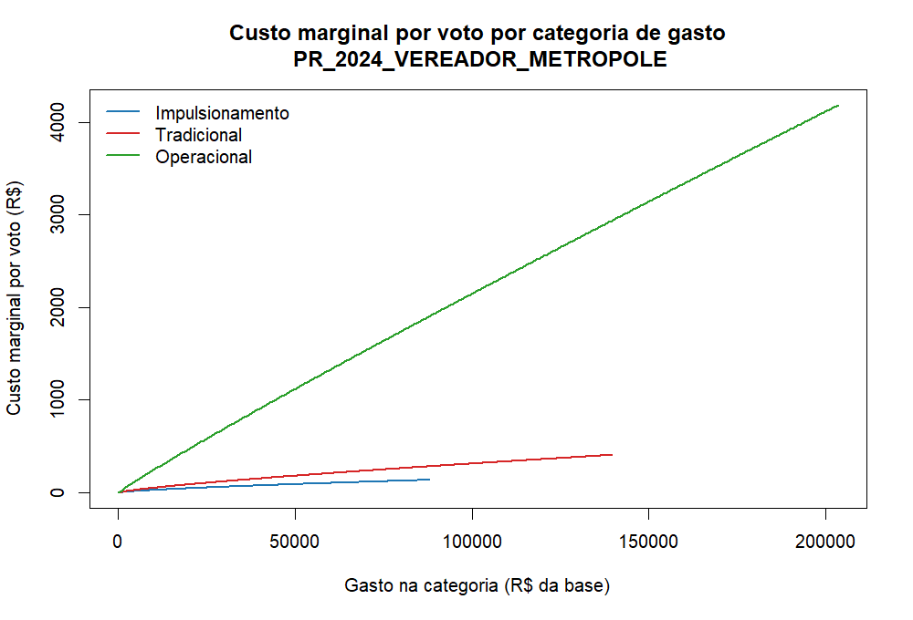

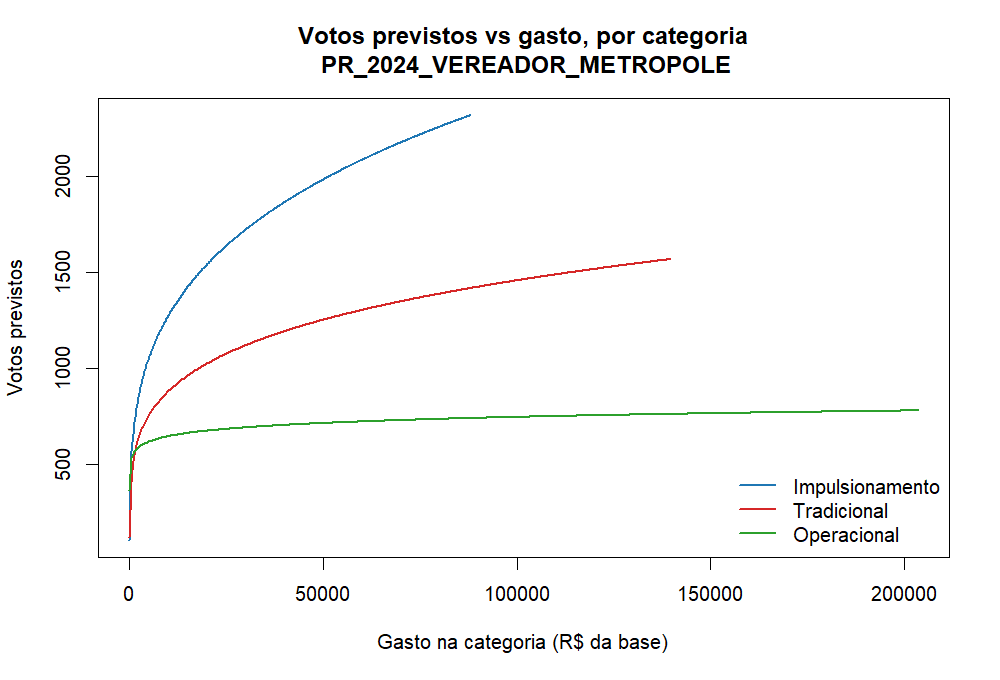

Limiar de custo por voto (media dos custos individuais): eleitos R$ 27; geral R$ 65.

| categoria | dose intensiva (b_lg) | n usuarios | saturacao (limiar eleitos) | saturacao (limiar geral) | faixa observada ate |
|---|---:|---:|---:|---:|---:|
| impulsionamento | 0,275 | 346 | R$ 9.215 | R$ 31.063 | R$ 88.000 |
| tradicional | 0,219 | 553 | R$ 4.305 | R$ 13.294 | R$ 139.758 |
| operacional | 0,063 | 514 | R$ 934 | R$ 2.390 | R$ 203.598 |

O ponto de saturacao e' o gasto na categoria a partir do qual cada voto
adicional custa mais do que o limiar (formula fechada na secao de metodo).
'Alem da faixa observada' significa que o cruzamento fica acima do quantil
99% do gasto observado dos usuarios, ou seja, e' extrapolacao.

---

## Reproducao

Execucao completa: `Rscript R/pipeline/run_all.R` (scripts 00 a 08), a partir da raiz do
repositorio. Determinismo verificado por md5 dos paineis tratados, das tabelas e das
figuras em duas execucoes (ver `docs/05_auditoria_e_reprodutibilidade.md`); o
inventario com md5 por arquivo e gravado em `MANIFEST.md`.
